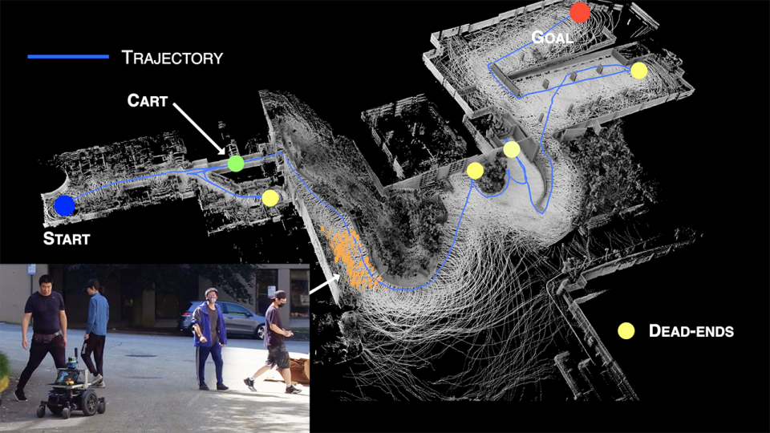
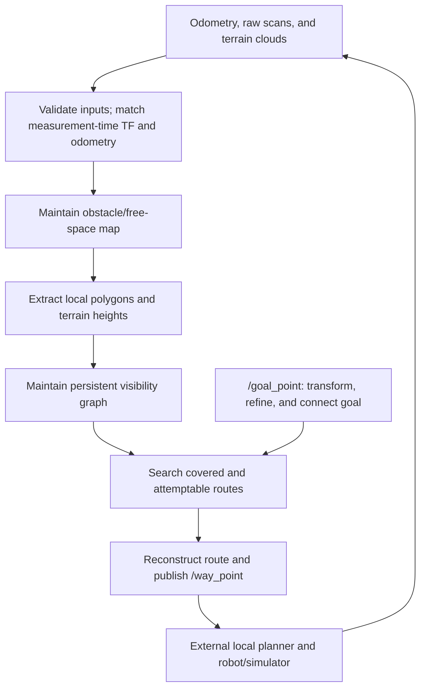
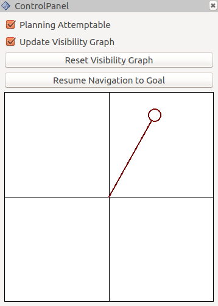
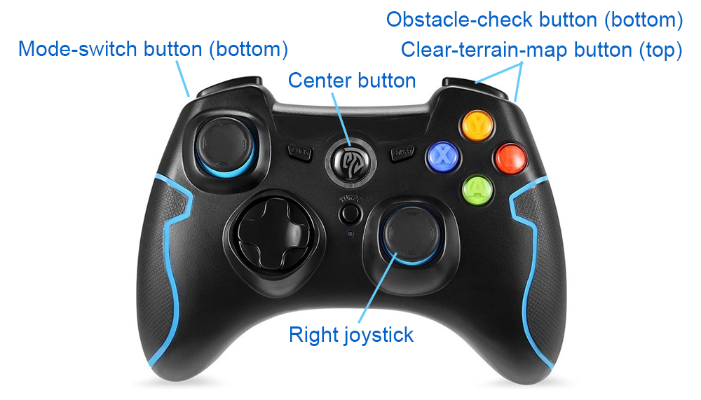

# FAR Planner

FAR Planner uses a dynamically updated visibility graph for fast replanning. The planner models the environment with polygons and builds a global visibility graph along with the navigation. The planner is capable of handling both known and unknown environments. In a known environment, paths are planned based on a prior map. In an unknown environment, multiple paths are attempted to guide the vehicle to goal based on the environment observed during the navigation. When dynamic obstacles are present, FAR Planner disconnects visibility edges blocked by the dynamic obstacles and reconnects them after regaining visibility. Graph maintenance and path search are separate processing stages. The current entry points process planner callbacks serially; see the [algorithm guide](docs/algorithm.md) for scheduling and validation details.

FAR Planner was used by the [CMU-OSU Team](https://www.subt-explorer.com) in attending [DARPA Subterranean Challenge](https://www.subtchallenge.com). In the final competition which took place in Louisville Mega Cavern, KY, the team's robots conducted the most complete traversing and mapping across the site (26 out of 28 sectors) among all teams, winning a "Most Sectors Explored Award".

[A video showing functionalities of FAR Planner is available.](https://youtu.be/5shnlyZ4L9M)

<p align="center">
  
</p>

## Branches

| Branch | ROS version | Build tool |
| --- | --- | --- |
| `humble-jazzy` (default) | ROS 2 Humble / Jazzy | colcon |
| `lyrical` | ROS 2 Lyrical | colcon |
| `melodic-noetic` | ROS 1 Melodic / Noetic | catkin |

Use the branch matching your ROS installation; its README contains the corresponding commands.

## Workflow

1. **Build the matching branch.** Select your ROS distribution above, then follow [Usage](#usage) to install dependencies and build the workspace.
2. **Start the robot or simulator stack.** Supply odometry, registered scans, terrain analysis, TF, and a local planner. The linked development environment supplies these components separately. Keep observations and transforms on the same ROS clock; see [Sensor inputs](#sensor-inputs).
3. **Launch FAR and set a goal.** Use RViz's **Goalpoint** tool to publish `/goal_point`. FAR updates its visibility graph and publishes intermediate `/way_point` targets; the external local planner performs obstacle-aware motion control.
4. **Inspect and validate.** Watch the graph, route, and waypoint in RViz. Arrival is relative to FAR's adjusted goal anchor; check robot position separately when exact requested-point proximity matters. Run the [development checks](#development) before changing planning behavior.

## Algorithm pipeline



Contours describe XY geometry with terrain-derived heights. Graph maintenance updates corner, visibility, and trajectory connections; route selection uses separate covered-space and attemptable searches. In dynamic mode, clearing occupied geometry requires free-ray evidence. The normal route policy does not guarantee a return to re-observe a blocked corridor. See the [algorithm guide](docs/algorithm.md) for module logic and timing contracts, and the [validation record](docs/validation.md) for tested behavior and remaining limitations.

| Package under `src/` | Responsibility |
| --- | --- |
| [`far_planner`](src/far_planner/) | Sensor processing, map/contour updates, graph maintenance, route search, and waypoint publication |
| [`graph_decoder`](src/graph_decoder/) | Read, validate, and save visibility graphs |
| [`boundary_handler`](src/boundary_handler/) | Generate a graph from custom polygon boundaries and a reference trajectory |
| [`visibility_graph_msg`](src/visibility_graph_msg/) | Shared graph messages and validation/export helpers |
| [`goalpoint_rviz_plugin`](src/goalpoint_rviz_plugin/), [`teleop_rviz_plugin`](src/teleop_rviz_plugin/) | RViz goal selection and navigation/teleoperation controls |

## Usage

The repository has been tested in Ubuntu 18.04 with ROS Melodic and Ubuntu 20.04 with ROS Noetic. Follow instructions in [Autonomous Exploration Development Environment](http://cmu-exploration.com) to setup the development environment. Make sure to checkout the branch that matches the computer setup, compile, and download the simulation environments.

To setup FAR Planner, clone the repository.
```
git clone https://github.com/MichaelFYang/far_planner
```
In a Bash terminal, source ROS, select the 'melodic-noetic' branch, install dependencies, and compile. Use `melodic` instead of `noetic` on Ubuntu 18.04. The dependency command assumes rosdep has been initialized and its index updated.
```sh
source /opt/ros/noetic/setup.bash
cd far_planner
git checkout melodic-noetic
rosdep install --from-paths src --ignore-src -r -y
catkin_make -DCMAKE_BUILD_TYPE=Release
```
To run the code, go to the development environment folder in a terminal, source the ROS workspace, and launch.
```
source devel/setup.bash
roslaunch vehicle_simulator system_indoor.launch
```
In another terminal, go to the FAR Planner folder, source the ROS workspace, and launch.
```
source devel/setup.bash
roslaunch far_planner far_planner.launch
```
Now, users can send a goal by pressing the 'Goalpoint' button in RVIZ and then clicking a point to set the goal. The vehicle will navigate to the goal and build a visibility graph (in cyan) along the way. Areas covered by the visibility graph become free space. When navigating in free space, the planner uses the built visibility graph, and when navigating in unknown space, the planner attempts to discover a way to the goal. By pressing the 'Reset Visibility Graph' button, the planner will reinitialize the visibility graph. By unchecking the 'Planning Attemptable' checkbox, the planner will first try to find a path through the free space. The path will show in green. If such a path does not exist, the planner will consider unknown space together. The path will show in blue. By unchecking the 'Update Visibility Graph' checkbox, the planner will stop updating the visibility graph. To read/save the visibility graph from/to a file, press the 'Read'/'Save' button. An example visibility graph file for indoor environment is available at 'src/far_planner/data/indoor.vgh'.

The Goalpoint tool publishes to `/goal_point` by default. Set its **Topic** property in RViz to use another goal topic; goals use RViz’s selected fixed frame.

<p align="center">
  
</p>

Anytime during the navigation, users can use the control panel to navigate the vehicle by clicking the in the black box. The system will switch to *smart joystick* mode - the vehicle tries to follow the virtual joystick command and avoid collisions at the same time. To resume FAR Planner navigation, press the 'Resume Navigation to Goal' button or use the 'Goalpoint' button to set a new goal. Note that users can use a PS3/4 or Xbox controller instead of the virtual joystick. For more information, please refer to our development environment page.

<p align="center">
  
  &nbsp;&nbsp;&nbsp;
  
</p>

To launch with a different environment, use the command lines below and replace '\<environment\>' with one of the environment names in the development environment, i.e. 'campus', 'indoor', 'garage', 'tunnel', and 'forest'. Note that when running in campus environment, set *checkTerrainConn* to true in system_campus.launch in the 'src/vehicle_simulator/launch' folder of the development environment.
```
roslaunch vehicle_simulator system_<environment>.launch
roslaunch far_planner far_planner.launch
```
To run FAR Planner in a [Matterport3D](https://niessner.github.io/Matterport) environment, follow instructions on the development environment page to setup the Matterport3D environment. Then, use the command lines below to launch the system and FAR Planner.
```
roslaunch vehicle_simulator system_matterport.launch
roslaunch far_planner far_planner.launch config:=matterport
```

<p align="center">
  
</p>

Users have the option to define custom navigation boundaries. To do this, users need to supply a boundary file and a trajectory file. Examples are provided as 'boundary.ply' and 'trajectory.txt' in the 'src/far_planner/data' folder. The files can be viewed by text editors. Specifically, the boundary file contains user-defined polygons where each polygon has an index. The trajectory file contains poses where each pose is a row with x (m), y (m), z (m), roll (rad), pitch (rad), yaw (rad), and time duration from start of the run (second). The trajectory file is in the same format as those saved by the development environment and needs to contain at least one pose to determine the traversable side of the navigation boundaries. Users can use the command line below to generate a visibility graph file in the same folder (provided as 'boundary_graph.vgh'), which can be loaded to FAR Planner using the 'Read' button.
```
roslaunch boundary_handler boundary_handler.launch
```

## Sensor inputs

The default launch connects these inputs to the autonomous exploration development environment:

| Planner input | Default topic | Content |
| --- | --- | --- |
| `/odom_world` | `/state_estimation` | Stamped robot pose |
| `/scan_cloud` | `/registered_scan` | Raw registered XYZ returns for ray tracing; intensity is optional |
| `/terrain_cloud` | `/terrain_map_ext` | Extended terrain with height cost in intensity |
| `/terrain_local_cloud` | `/terrain_map` | Local terrain with height cost in intensity |

Terrain intensity must encode traversability height cost, not lidar reflectivity. For example, zero reflectivity on a wall must not be interpreted as free terrain. Clouds and odometry must use the same ROS clock; see the [TF/time contract](docs/algorithm.md#tf-and-timestamp-contract) for interpolation and queue limits. Configure `util/dynamic_obs_dacay_time` (`Util/` on ROS 1) to outlast upstream terrain retention and pruning lag; the default is 15 seconds. This interval expires clearing exclusions; it does not expire occupied geometry that has not been observed free.

## Development

See [the algorithm guide](docs/algorithm.md) for the data flow, TF/time contract, and invariants. The [validation record](docs/validation.md) contains regression cases, SDK checks, measurements, and known integration failures.

For rendered Goalpoint and TeleopPanel regression checks, see the optional [RViz interaction test](tests/rviz_interaction/README.md). It builds separately and keeps its logs and screenshots outside the source tree.

This branch contains six ROS 1 catkin packages under `src/`. See [AGENTS.md](AGENTS.md) for contributor conventions. `catkin_make` generates the local `src/CMakeLists.txt`; do not commit that machine-specific file.

Build and run registered tests with:

```sh
catkin_make -DCMAKE_BUILD_TYPE=RelWithDebInfo
catkin_make run_tests
catkin_test_results
```

Registered checks cover measurement-time TF, sensor callbacks, graph/search behavior, and file parsing. The core C++ suite runs through rostest with its own ROS master; Python tests use the interpreter selected by catkin for Melodic or Noetic. Validate planning and vehicle-control changes in the simulator as well, recording the environment and results.

Use `roslaunch far_planner far_planner.launch use_rviz:=false` for headless startup. The decoder subscribes to `/robot_vgraph` by default; select another topic with `roslaunch graph_decoder decoder.launch graph_topic:=/custom_graph`.

Boundary inputs use ASCII PLY with a vertex element first and named scalar `x`, `y`, `z`, and `poly_index` properties in any order (up to one million vertices). Coordinates must be finite and polygon IDs must be integers. The trajectory file's first three values are finite `x y z`. Invalid files fail before the graph is saved. The boundary extractor accepts `folder_path:=/path/to/data` and `use_rviz:=false`. Direct `rosrun boundary_handler boundary_handler` uses the `far_planner/data` directory by default; pass `_graph_file:=/tmp/boundary_graph.vgh` to keep the sample graph untouched. Use a separate writable directory containing the boundary and trajectory inputs to avoid overwriting the sample graph; a trailing slash is optional. Individual file parameters may be absolute paths.

See the [TF and timestamp contract](docs/algorithm.md#tf-and-timestamp-contract) for input timing requirements and `/far_planner/sensor_time_tolerance`.

## Configuration

FAR Planner settings are kept in default.yaml in the 'src/far_planner/config' folder. For Matterport3D environments, the settings are in matterport.yaml in the same folder.
- *is_static_env* (default: true) - set to false if the environment contains dynamic obstacles.
- *is_attempt_autoswitch* (default: true) - set to false to turn off auto switch from non-attemptable navigation (for known environment) to attemptable navigation (for unknown environment).
- *is_viewpoint_extend* (default: true) - set to false to stop extending visibility graph vertices away from objects to gain better viewpoints.
- *is_pub_boundary* (default: false) - set to true to send custom navigation boundaries to the local planner in the development environment.

## Reference

- F. Yang, C. Cao, H. Zhu, J. Oh, and J. Zhang. FAR Planner: Fast, Attemptable Route Planner using Dynamic Visibility Update. IEEE/RSJ Intl. Conf. on Intelligent Robots and Systems (IROS). Kyoto, Japan, Oct. 2022. **Best Student Paper Award.**

## Author

[Fan Yang](https://github.com/MichaelFYang) (michael.yfan24@gmail.com)

## License

Licensed under the [MIT License](LICENSE). Copyright (c) 2021-2026 Fan Yang and contributors. Existing author credits are retained in the source files.
