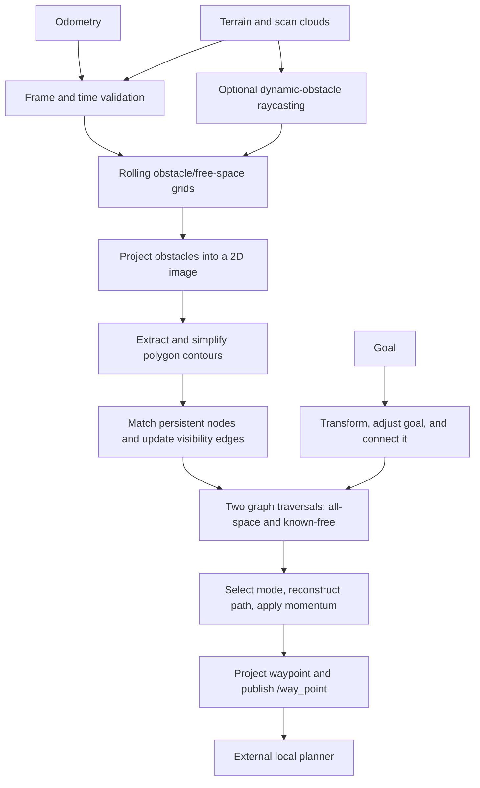

# FAR Planner: algorithm, data flow, and refactor plan

This document records the implementation on the `refactor/*` branches. It describes the current code, distinguishes findings from proposed changes, and defines checks for incremental refactoring. The algorithm is shared across ROS 1 and ROS 2; scheduling, messages, TF APIs, and build dependencies differ.

## Main idea

FAR represents obstacles as polygons and routes through a persistent visibility graph. It rebuilds local obstacle contours from terrain data, matches their vertices to persistent navigation nodes, and re-evaluates nearby graph edges. Searching this sparse graph avoids searching the full point cloud for each goal.

There are two navigation modes: a route constrained to observed/covered space, and an attemptable route that can extend toward unknown space. Goal adjustment, edge-vote history, and path momentum stabilize decisions as observations change. The output is an intermediate waypoint for a separate local planner, not direct velocity control.

## Implementation map

| Stage | Main implementation | Responsibility |
| --- | --- | --- |
| Orchestration | [far_planner.cpp](../src/far_planner/src/far_planner.cpp), `FARMaster` | Sensor callbacks, scheduling, goal lifecycle, waypoint publication |
| Local map | [map_handler.cpp](../src/far_planner/src/map_handler.cpp), `MapHandler` | Rolling obstacle/free-cloud cells, terrain heights, neighborhood queries |
| Dynamic observations | [scan_handler.cpp](../src/far_planner/src/scan_handler.cpp), `ScanHandler` | Voxel raycasting and scan-versus-map obstacle comparison |
| Polygon extraction | [contour_detector.cpp](../src/far_planner/src/contour_detector.cpp), `ContourDetector` | Image projection, blur, contour extraction, polygon simplification |
| Contour topology | [contour_graph.cpp](../src/far_planner/src/contour_graph.cpp), `ContourGraph` | Polygon orientation, convexity, persistent-node matching, intersection tests |
| Graph maintenance | [dynamic_graph.cpp](../src/far_planner/src/dynamic_graph.cpp), `DynamicGraph` | Node creation/removal, visibility/contour/trajectory edges, temporal votes |
| Route selection | [graph_planner.cpp](../src/far_planner/src/graph_planner.cpp), `GraphPlanner` | Goal connection, graph search, mode selection, path reconstruction |
| Terrain connectivity | [terrain_planner.cpp](../src/far_planner/src/terrain_planner.cpp), `TerrainPlanner` | Local eight-neighbor grid search for trajectory-edge feasibility |
| Graph exchange | [graph_msger.cpp](../src/far_planner/src/graph_msger.cpp), [decoder_node.cpp](../src/graph_decoder/src/decoder_node.cpp) | Graph messages, graph import/export, saved graph loading |
| Boundary preprocessing | [graph_extractor.cpp](../src/boundary_handler/src/graph_extractor.cpp) | Build a graph from a supplied polygon boundary and reference trajectory |

## One update cycle

1. **Accept observations.** Odometry sets robot position and heading. Cloud callbacks convert incoming data to PCL, filter invalid points, downsample it, and transform it into `world_frame`. Terrain point intensity is compared with `FARUtil::kFreeZ` to divide free and obstacle samples; it is not simply reflectivity throughout this pipeline.
2. **Update local map state.** `TerrainCallBack` updates rolling map cells and terrain heights, extracts nearby clouds, and maintains time-decayed new-obstacle clouds. In dynamic mode, scan raycasting detects discrepancies and removes obsolete obstacle observations.
3. **Build local contour topology.** `ContourDetector` projects obstacles to an XY image, inflates pixel occupancy, resizes/blurs it, calls OpenCV `findContours`, and applies `approxPolyDP` plus topology/adjacency filters. `ContourGraph` builds polygon-linked contour nodes and classifies surface directions and convexity. Terrain data supplies node heights: this is not a full arbitrary 3D visibility graph.
4. **Maintain the persistent graph.** Match nearby old nodes to current contour vertices; add valid unmatched vertices and intermediate trajectory nodes. Remove merged/invalid nodes and update odometry connections. Recheck pairs of nearby nodes, relevant old edges, and contour-boundary connections. Edge decisions combine direction constraints, polygon intersection, terrain feasibility, and accumulated votes. Already traversed trajectory connections provide additional connectivity.
5. **Prepare route search.** Adjust the goal against local free/obstacle terrain and refresh goal edges. Initialize distances and parent pointers. One Dijkstra-style traversal fills `gscore`/`parent`; a second fills `fgscore`/`free_parent` using covered neighbors and stricter goal admissibility. Costs are Euclidean distance, with a slope-related adjustment for certain goal edges in the general traversal.
6. **Choose and publish.** `PathToGoal` selects the known-free or attemptable parent tree, applies bounded path momentum, reconstructs a route, and chooses the next unreached navigation node. `ProjectNavWaypoint` can extend around convex corners and blend heading. `/way_point` feeds the external local planner; failure handling can publish the robot's current position to stop it.

`TerrainPlanner` is a separate A*-style search over an eight-neighbor local grid, constrained to a corridor around a candidate trajectory edge. It does not replace the persistent visibility-graph route search.

## State and scheduling

`Polygon` and `CTNode` represent local topology. `NavNode` stores persistent geometry, multiple adjacency lists, vote histories, coverage flags, and search state. `FARUtil`, `DynamicGraph`, `ContourGraph`, and `MapHandler` also hold substantial static state. Containers often copy shared pointers, so a copied node vector is not an immutable graph snapshot.

On ROS 2, both graph-update and planning wall timers use `main_run_freq`, and `main()` calls `rclcpp::spin(node)`: the planner callbacks are serialized by the single-threaded executor. The TF listener may use its own thread. On ROS 1, the main loop calls `ros::spinOnce()` and performs graph work; the planning timer runs through that callback processing. The repository's implementation should not be described as two independently parallel planner threads. Introducing parallel callbacks requires a separate ownership/synchronization design.

## TF and timestamp contract

A measurement in frame `sensor` at time `t` must use `T_world_sensor(t)`, with target frame first and source frame second in the lookup. A nonzero input timestamp must not silently become a latest-transform query. TF time zero explicitly requests the latest available transform; a bounded wait can accommodate delayed TF delivery. See the [official tf2 time tutorial](https://raw.githubusercontent.com/ros2/ros2_documentation/jazzy/source/Tutorials/Intermediate/Tf2/Learning-About-Tf2-And-Time-Cpp.rst). A [TF message filter](https://raw.githubusercontent.com/ros2/ros2_documentation/jazzy/source/Tutorials/Intermediate/Tf2/Using-Stamped-Datatypes-With-Tf2-Ros-MessageFilter.rst) can queue stamped inputs until their transforms are available.

The timestamped-transform stage fixes the following confirmed defects:

- Cloud and odometry lookups now use the original ROS measurement timestamp, including nanoseconds before PCL rounds timestamps to microseconds. They no longer request the latest pose for a stamped measurement.
- `ProcessCloud` builds a candidate and commits it only after a successful transform. Its callers return on failure before changing map state. Goal transform failures also propagate and prevent goal replacement.
- Empty frame IDs are rejected; leading slashes are normalized consistently. Zero-stamped sensor clouds and odometry are rejected. Zero remains an explicit latest-transform request for operator goals.
- TF queries do not block the planner executor. If the requested transform is unavailable, the observation is dropped with a diagnostic; it is not retried or replaced with the latest transform. Upstream TF must arrive before the measurement. Bounded buffering remains a separate improvement.

Remaining timing work is explicit:

- Scan, local-terrain, and terrain-map inputs still lack a cross-stream skew policy. Scan ray origins still use the latest robot position rather than the scan-time position.
- Out-of-order observations, delayed TF buffering, and simulated-clock resets need dedicated policies and regression coverage. Graph exchange also needs a consistent timestamp/frame contract.
- A timestamped rigid transform does not deskew a spinning scan: upstream per-point timing and motion compensation are required. An aggregated terrain map needs a documented upstream frame/time convention.

`test/test_frame_transforms.cpp` covers moving transforms, interpolation, nanosecond precision, unavailable/past/future TF, zero stamps, frame normalization, and unchanged inputs on failure. The ROS 2 `test/test_terrain_tf.py` exercises the actual node: a cloud at 10 s uses the 10 s transform despite a newer 12 s transform, and rejected clouds never reach map publication. These tests do not establish end-to-end navigation safety or complete sensor synchronization.

## Invariants to preserve

- Every accepted geometric value used by the planner is in the configured world frame. Failed or unavailable transforms must not mutate accepted map, odometry, or goal state.
- Node IDs remain stable and resolve to live nodes; deleting a node removes its adjacency, vote, and lookup references.
- Undirected graph operations maintain reciprocal edges. Known-free and attemptable graph policies remain distinct.
- Search costs are nonnegative. Priority-queue keys must remain valid after a distance improvement; the parent chain must terminate at the start.
- Geometry thresholds, boundary restrictions, and momentum behavior are preserved unless a separately tested behavior change is intentional.
- Optimization must not remove defensive copies where an operation mutates the container being traversed.

## Step-by-step simplification and efficiency work

| Step | Change | Required evidence |
| --- | --- | --- |
| 1 — foundation | Branch-specific dependencies/builds, portable setup, MIT notices, plugin cleanup | Native Jazzy/Lyrical/Noetic builds; launch and plugin smoke checks |
| 2 — frame/time correctness | Timestamped TF queries and explicit failure propagation, then cross-stream timing policy | Moving transforms at distinct times; unavailable/past/future TF; zero stamps; simulated-time jumps; unchanged state on failure |
| 3 — search correctness | Audit mutable priority-queue keys in both graph traversals and terrain search; consolidate only identical mechanics | A graph where a queued node's best cost decreases; reference shortest-path comparisons; covered-space constraints |
| 4 — graph lifecycle | Replace invalid `erase(it--)` loops; audit ownership cycles, ID maps, and adjacency cleanup | Remove first/last/consecutive nodes; repeated resets; sanitizer checks and live-node accounting |
| 5 — file boundaries | Validate graph/boundary/trajectory input and fail without partial state updates | Truncated/malformed files, missing fields, large IDs, round trips, invalid coordinates |
| 6 — measured hot paths | Remove proven unnecessary copies/allocations; bound pair iteration; avoid avoidable rebuilds | Identical graph/path results; allocation counts; median/p95 stage timing over representative graph sizes |

Confirmed review findings also include an unchecked trajectory Y/Z parse, an unbounded boundary token read, and missing vertex-count validation. The graph KD-tree builder needs review because it allocates for all graph nodes but skips some while filling. These findings should become regression cases, not broad speculative rewrites.

Potential costs are point-cloud conversion/downsampling and neighborhood reconstruction, image processing, roughly quadratic nearby-node pair checks, graph serialization/KD-tree rebuilds, and graph traversals. Complexity is a prioritization aid, not a measured bottleneck. Existing `/runtime` and `/planning_time` measurements cover different scopes and units; normalize benchmark reporting before comparing them. Record point count, contour/graph size, edge count, configuration, CPU, ROS version, and correctness results with each performance claim.

## Branch validation baseline

The foundation builds on native Jazzy and on official Noetic and Lyrical desktop containers. Jazzy and Lyrical report 232 checks, zero failures, and 58 skips; these are predominantly lint/generated-code checks. Noetic initially registers zero behavioral tests. Headless planner startup, decoder remapping, and generation of a 25-node example boundary graph pass on all three tested distributions. These checks do not establish end-to-end navigation correctness; the refactor must add behavioral regressions and representative replay/simulation validation.
