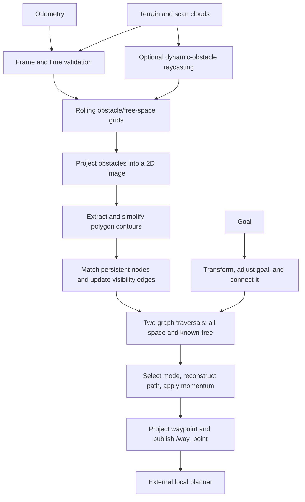

# FAR Planner: algorithm, data flow, and refactor plan

This document records the implementation on the `refactor/*` branches. It describes the current code, distinguishes findings from proposed changes, and defines checks for incremental refactoring. The algorithm is shared across ROS 1 and ROS 2; scheduling, messages, TF APIs, and build dependencies differ.

## Main idea

FAR represents obstacles as polygons and routes through a persistent visibility graph. It rebuilds local obstacle contours from terrain data, matches their vertices to persistent navigation nodes, and re-evaluates nearby graph edges. Searching this sparse graph avoids searching the full point cloud for each goal.

There are two navigation modes: a route constrained to observed/covered space, and an attemptable route that can extend toward unknown space. Goal adjustment, edge-vote history, and path momentum stabilize decisions as observations change. The output is an intermediate waypoint for a separate local planner, not direct velocity control.

## Implementation map

| Stage | Main implementation | Responsibility |
| --- | --- | --- |
| Orchestration | [far_planner.cpp](../src/far_planner/src/far_planner.cpp), `FARMaster` | Sensor callbacks, scheduling, goal lifecycle, waypoint publication |
| Local map | [map_handler.cpp](../src/far_planner/src/map_handler.cpp), `MapHandler` | Rolling obstacle/free-cloud cells, terrain heights, neighborhood queries |
| Dynamic observations | [scan_handler.cpp](../src/far_planner/src/scan_handler.cpp), `ScanHandler` | Voxel raycasting and scan-versus-map obstacle comparison |
| Polygon extraction | [contour_detector.cpp](../src/far_planner/src/contour_detector.cpp), `ContourDetector` | Image projection, blur, contour extraction, polygon simplification |
| Contour topology | [contour_graph.cpp](../src/far_planner/src/contour_graph.cpp), `ContourGraph` | Polygon orientation, convexity, persistent-node matching, intersection tests |
| Graph maintenance | [dynamic_graph.cpp](../src/far_planner/src/dynamic_graph.cpp), `DynamicGraph` | Node creation/removal, visibility/contour/trajectory edges, temporal votes |
| Route selection | [graph_planner.cpp](../src/far_planner/src/graph_planner.cpp), `GraphPlanner` | Goal connection, graph search, mode selection, path reconstruction |
| Terrain connectivity | [terrain_planner.cpp](../src/far_planner/src/terrain_planner.cpp), `TerrainPlanner` | Local eight-neighbor grid search for trajectory-edge feasibility |
| Graph exchange | [graph_msger.cpp](../src/far_planner/src/graph_msger.cpp), [decoder_node.cpp](../src/graph_decoder/src/decoder_node.cpp) | Graph messages, graph import/export, saved graph loading |
| Boundary preprocessing | [graph_extractor.cpp](../src/boundary_handler/src/graph_extractor.cpp) | Build a graph from a supplied polygon boundary and reference trajectory |

## One update cycle

1. **Accept observations.** Odometry sets robot position and heading. Cloud callbacks convert incoming data to PCL, filter invalid points, downsample it, and transform it into `world_frame`. Terrain point intensity is compared with `FARUtil::kFreeZ` to divide free and obstacle samples; it is not simply reflectivity throughout this pipeline.
2. **Update local map state.** `TerrainCallBack` updates rolling map cells and terrain heights, extracts nearby clouds, and maintains time-decayed new-obstacle clouds. In dynamic mode, scan raycasting detects discrepancies and removes obsolete obstacle observations.
3. **Build local contour topology.** `ContourDetector` projects obstacles to an XY image, inflates pixel occupancy, resizes/blurs it, calls OpenCV `findContours`, and applies `approxPolyDP` plus topology/adjacency filters. `ContourGraph` builds polygon-linked contour nodes and classifies surface directions and convexity. Terrain data supplies node heights: this is not a full arbitrary 3D visibility graph.
4. **Maintain the persistent graph.** Match nearby old nodes to current contour vertices; add valid unmatched vertices and intermediate trajectory nodes. Remove merged/invalid nodes and update odometry connections. Recheck pairs of nearby nodes, relevant old edges, and contour-boundary connections. Edge decisions combine direction constraints, polygon intersection, terrain feasibility, and accumulated votes. Already traversed trajectory connections provide additional connectivity.
5. **Prepare route search.** Adjust the goal against local free/obstacle terrain and refresh goal edges. Initialize distances and parent pointers. One Dijkstra-style traversal fills `gscore`/`parent`; a second fills `fgscore`/`free_parent` using covered neighbors and stricter goal admissibility. Costs are Euclidean distance, with a slope-related adjustment for certain goal edges in the general traversal.
6. **Choose and publish.** `PathToGoal` selects the known-free or attemptable parent tree, applies bounded path momentum, reconstructs a route, and chooses the next unreached navigation node. `ProjectNavWaypoint` can extend around convex corners and blend heading. `/way_point` feeds the external local planner; failure handling can publish the robot's current position to stop it.

`TerrainPlanner` is a separate A*-style search over an eight-neighbor local grid, constrained to a corridor around a candidate trajectory edge. It does not replace the persistent visibility-graph route search.

For a convex waypoint with no obstacles inside its local crop, viewpoint extension now returns the computed projected point instead of silently returning the unextended navigation point. The ROS 1 helper also uses its supplied node argument consistently. A focused regression covers this branch; it does not measure navigation performance.

## State and scheduling

`Polygon` and `CTNode` represent local topology. `NavNode` stores persistent geometry, multiple adjacency lists, vote histories, coverage flags, and search state. `FARUtil`, `DynamicGraph`, `ContourGraph`, and `MapHandler` also hold substantial static state. Containers often copy shared pointers, so a copied node vector is not an immutable graph snapshot.

On ROS 2, both graph-update and planning wall timers use `main_run_freq`, and `main()` calls `rclcpp::spin(node)`: the planner callbacks are serialized by the single-threaded executor. The TF listener may use its own thread. On ROS 1, the main loop calls `ros::spinOnce()` and performs graph work; the planning timer runs through that callback processing. The repository's implementation should not be described as two independently parallel planner threads. Introducing parallel callbacks requires a separate ownership/synchronization design.

## TF and timestamp contract

A measurement in frame `sensor` at time `t` must use `T_world_sensor(t)`, with target frame first and source frame second in the lookup. A nonzero input timestamp must not silently become a latest-transform query. TF time zero explicitly requests the latest available transform; a bounded wait can accommodate delayed TF delivery. See the [official tf2 time tutorial](https://raw.githubusercontent.com/ros2/ros2_documentation/jazzy/source/Tutorials/Intermediate/Tf2/Learning-About-Tf2-And-Time-Cpp.rst). A [TF message filter](https://raw.githubusercontent.com/ros2/ros2_documentation/jazzy/source/Tutorials/Intermediate/Tf2/Using-Stamped-Datatypes-With-Tf2-Ros-MessageFilter.rst) can queue stamped inputs until their transforms are available.

The timestamped-transform stage fixes the following confirmed defects:

- Cloud and odometry lookups use the original ROS measurement timestamp, including nanoseconds before PCL rounds timestamps to microseconds. Identity-frame clouds also receive that timestamp in PCL metadata, so both transform paths report the same measurement time. Stamped measurements never request the latest pose.
- On ROS 2, cloud TF applies the stamped rigid transform directly to the PCL cloud and preserves its non-coordinate fields and metadata. This removes the PointCloud2 serialization round trip and the `tf2_sensor_msgs` dependency; throughput has not been measured. The original ROS timestamp still selects the transform before PCL rounds its header stamp.
- `ProcessCloud` builds a candidate and commits it only after a successful transform. Its callers return on failure before changing map state. Goal transform failures also propagate and prevent goal replacement.
- Empty frame IDs are rejected; leading slashes are normalized consistently. Zero-stamped sensor clouds and odometry are rejected. Zero remains an explicit latest-transform request for operator goals.
- RViz goal clicks use the current fixed frame for their XY coordinates. The tool transforms its latest stamped odometry pose into that frame before copying the robot height; if the transform is unavailable, it does not publish the goal. Before any odometry arrives, the goal height defaults to zero. Each click publishes one goal and then the resume command, avoiding a duplicate planner goal reset.
- TF queries do not block the planner executor. Bounded odometry, scan, local-terrain, and terrain queues wait for their stamped TF and, where needed, matching odometry without silently using the latest transform.
- Before PCL conversion, PointCloud2 inputs require a complete native-endian binary layout with distinct, nonoverlapping float32 XYZ fields. Terrain and local-terrain clouds also require a distinct float32 intensity field for free/obstacle classification, and points with nonfinite intensity are removed; scans may omit intensity. Malformed inputs are rejected before entering the TF queues. A zero-width, zero-row-step local cloud with no data remains an explicit clear measurement.

The cross-stream timing stage adds the following policies:

- Each odometry, scan, local-terrain, and terrain stream must advance strictly in timestamp order. Rejected observations do not advance the accepted stamp. Odometry also requires finite coordinates and a nonzero finite quaternion; valid samples wait in order for delayed stamped TF.
- Scans require exact or interpolated world-frame odometry at their timestamp. History retains at most 2,000 samples and 10 seconds; both interpolation samples must be within `sensor_time_tolerance`, with no extrapolation. Scans can wait briefly for the later sample. Rays start at the timestamped sensor-frame TF origin when available, or at interpolated odometry for world-frame scans.
- Terrain and local-terrain clouds require exact or interpolated odometry at their header stamp. Each interpolation sample must be within `sensor_time_tolerance` of that stamp; no pose is extrapolated. A cloud already more than the tolerance behind the latest accepted odometry is rejected on arrival. Once queued, newer odometry does not invalidate a cloud with a valid pose still in history. Terrain and local-terrain queues hold at most two clouds each and expire entries by steady time while waiting for later odometry or stamped TF. Terrain map cropping and height analysis use the measurement-time pose.
- Dynamic-obstacle clearing uses the closest processed scan within `sensor_time_tolerance` of the terrain stamp and restores that scan’s measurement-time sensor origin before tracing rays. Equal-distance ties prefer the earlier scan. In dynamic mode, terrain waits up to 250 ms from its arrival when no compatible scan has been processed or one is queued for odometry or TF. This also lets a scan arriving after terrain contribute to the same update. A second queued terrain releases the older one immediately, so high-rate terrain does not wait itself out of the two-entry queue. The normal terrain queue expiry still applies. Up to 32 processed scans are retained; scans too old for later terrain updates are pruned. If none matches after the wait, the map update proceeds without scan-based clearing. Existing dynamic exclusions continue to decay.
- `sensor_time_tolerance` defaults to **0.2 seconds** and must be in `(0, 10]`. Configure it in the planner parameters (`/far_planner/sensor_time_tolerance` on ROS 1) to match the upstream publication rate and motion/error budget. A larger value permits greater temporal mismatch; it does not improve synchronization.
- All inputs must use the planner's ROS clock. Zero sensor stamps and stamps ahead of that clock by more than the tolerance are rejected. A backward clock jump clears sensor history, map, graph, and goal state, publishes a stop waypoint, and waits for fresh odometry/terrain. Explicit graph reset also clears cached observations. The TF provider must supply transforms for the new epoch.

`test/test_frame_transforms.cpp` covers moving transforms, interpolation, nanosecond precision, unavailable/past/future TF, zero stamps, frame normalization, and unchanged inputs on failure. `test/test_sensor_timing.cpp` covers bounded odometry and scan histories, nearest-scan selection, ordered/expiring queues, pending-scan matching, interpolation limits, skew, and clock-rewind detection. `test/test_local_terrain_callback.cpp` checks measurement-time odometry matching, stale local-cloud rejection, waiting for later odometry, and an empty clear without a TF. The ROS 2 `test/test_terrain_tf.py` exercises timestamped cloud conversion, atomic rejection, delayed TF for odometry, scans, and terrain after newer odometry, terrain-time cropping, invalid/out-of-order odometry, duplicate terrain, skew rejection, older-scan selection after a newer scan, queued-scan TF pairing, scan arrival after terrain, and simulated-time reset. The ROS 1 `test/test_scan_tf_ros1.py` exercises delayed odometry and TF in the running node.

Remaining limits are explicit:

- Odometry, scans, local-terrain, and terrain retry only within their bounded queue lifetimes; TF arriving after expiry cannot recover that observation. The 0.2-second tolerance is a configurable policy, not a verified setting for every robot.
- World-frame scan clouds have no separate sensor frame, so their rays still start at the odometry reference point. Sensor-frame scans use their timestamped TF origin. A rigid cloud transform does not deskew a spinning scan; upstream per-point timing and motion compensation are required.
- Local terrain rejects clouds already stale on arrival and waits for exact or nearby bracketing odometry at its own stamp before replacing the local obstacle view. Its obstacle view then persists until a newer valid cloud or explicit empty clear arrives. A scan arriving after the 250 ms terrain wait cannot retroactively affect that update. This wait adds up to 250 ms of terrain latency when no compatible scan arrives. Aggregated terrain maps still need a documented upstream frame/time convention; they cannot be made simultaneous with a scan by assigning one header stamp. Graph publication time is not an aggregate observation time.
- These tests do not establish end-to-end navigation correctness. Validate synchronized bag replay and motion on the actual robot before adopting the refactor branches.

## Search correctness stage

The two visibility-graph traversals and terrain A* now push an immutable cost with each queue entry. Every distance improvement adds a new entry; an older entry is skipped when popped. This removes both mutable comparator keys and the separate open-set bookkeeping. The general graph traversal retains its slope-adjusted goal cost, while the covered traversal retains its coverage and free-goal restrictions. Terrain A* still uses Euclidean step costs and a Euclidean heuristic. Each query now clears search scores and parent links only for grid cells touched by the previous query; new nodes start with infinite scores. A failed query followed by successful queries has regression coverage. The reduced reset work is not yet a measured planner throughput gain.

A five-node geometric graph demonstrated the old failure: the cost to node 1 settled at 45 instead of the 44.89018 route through node 3. `test/test_search.cpp` now checks both graph traversals against an independent quadratic shortest-path reference over 40 deterministic graphs with covered/uncovered nodes. It also checks an obstacle-grid terrain route. These tests establish search behavior for the covered cases, not the whole navigation stack.

Goal snapping now marks only the closest navigation point after scanning all candidates. Previously, each improving candidate retained `is_goal`, making a discarded point appear static after later goal resets. The new regression fails on the old behavior and checks selection plus replacement.

When local terrain occupies the goal grid, free-space classification requires a cell marked free without an overlapping inflated obstacle. Previously, one overlapping free sample could admit the goal to the covered traversal even when no free cell existed; a nearby navigation node could also bypass that blocked terrain. The navigation-node fallback now applies only when the goal grid has no terrain cells. A route-level regression fails on the old behavior and checks blocked terrain, obstacle removal, and the no-terrain fallback.

Planner reset now clears the selected goal before dropping its pointer. Temporary goal removal also erases the node ID index entry, allowing the node to be released instead of accumulating across goal changes; lifecycle regressions failed before these fixes.

Terrain A* now rejects a diagonal step if either adjacent cardinal cell is occupied. A two-obstacle corner regression failed on the old path, and the updated obstacle-grid route has an independently checked shortest length of 6 m under the corner-safe rule.

## Graph lifecycle stage

`EraseNodeFromStack` now uses stable remove-and-erase for all matching pointers, including the first element and adjacent copies. Merged-node removal uses the iterator returned by `erase`, so removing the first or consecutive nodes does not decrement past `begin()`.

A full graph reset now clears reciprocal navigation edges, potential connections, trajectory links, search-parent links, and navigation-to-contour references before releasing graph storage. Full contour reset clears the reciprocal vertex links and contour-node edges. `test/test_graph_lifecycle.cpp` verifies first/last/consecutive erasure and that linked navigation and contour vertices are actually destroyed after reset; both ownership tests failed before the fix.

Merged-node and temporary-goal deletion also clear both sides of terrain-feasibility vote histories through the node ID map. These histories can exist for rejected pairs with no visibility edge, so adjacency alone cannot find them. Histories between surviving nodes remain intact. Regressions cover terrain-only neighbors and 32 goal replacements; the previous implementation retained stale node IDs after each removal.

Normal contour replacement now clears reciprocal front/back and connection links before dropping the old topology. Navigation nodes may still hold an old vertex until rematching later in the same serialized update, but that vertex no longer retains its old polygon neighbors. A lifecycle test confirms retired vertices are released after the last navigation reference is removed. Long-running heap profiling is still needed to rule out other ownership growth.

Pillar classification now uses the closed polygon perimeter, including the last-to-first edge. A regression triangle has a 7 m open chain and a 12 m perimeter, crossing a 10 m pillar threshold. The pillar fallback also sets both surface directions to its sentinel value.

Default planner `Point3D` values initialize XYZ and intensity to zero. Polygon, contour-node, and navigation-node scalar fields also have explicit neutral defaults; their factories no longer clear newly empty containers or restate neutral flags. The boundary extractor and graph decoder use coordinate-only points with zero-initialized XYZ. Contour pixels construct a complete point directly, so their intensity is defined before PCL conversion. `Point3D::operator!=` is the complement of its tolerant equality, including at the tolerance boundary and for nonfinite coordinates. The unused `point_hash` and `point_comp` helpers were removed because exact float hashing was inconsistent with tolerant equality; remaining Boost hash users include their header directly.

## Trajectory sampling stage

Trajectory sampling runs on every enabled graph-extraction call, even when the contour matcher has no new vertices. The previous empty-contour return skipped both initial trajectory creation and a bridge point requested by `IsInterNavpointNecessary`. Sampling uses that existing distance/connectivity policy and its recorded free-odometry position. Extraction clears its output each time, and graph-update freezing skips extraction at the caller.

Unit regressions cover initial sampling, a requested bridge position, and no repeated sample while stationary. A live ROS 2 test suppresses all obstacle vertices with the image threshold and checks that one trajectory node is published and remains stable across graph ticks. The ROS 1 callback regression checks trajectory initialization under the same empty-vertex condition.

## Boundary input stage

The boundary extractor reads ASCII PLY through a bounded, checked parser. The vertex element must come first and declare scalar `x`, `y`, `z`, and `poly_index` properties; their column order may vary. It accepts at most one million vertices with finite coordinates and integer-valued polygon IDs, and rejects missing or duplicate properties and truncated rows before modifying the polygon stack. Parsed vertices feed polygon grouping directly, without a temporary PCL cloud. Segment intersection uses a local 2D point type, so the extractor has no OpenCV dependency. The trajectory reader requires finite X, Y, and Z values; extra trajectory fields remain allowed for the sample format. File streams close automatically, and the executable reports an input error without saving a partial graph. Parser and intersection tests cover malformed input and segment edge cases. Process smoke checks verify the sample still produces 25 nodes and malformed input exits without a graph.

Boundary configuration normalizes `world_frame`, requires a positive finite `visual_scale_ratio` and a nonnegative finite `height_tolz`, and resolves relative filenames against `folder_path` with or without a trailing slash. Direct execution defaults to the installed `far_planner/data` directory, matching the launch file. Absolute filenames remain unchanged. Invalid settings fail before reading inputs or writing a graph.

The extractor builds graph and free-position markers only while their topics have subscribers. Its one-second loop checks again for viewers that connect later. Completed graph markers move into the outgoing array instead of copying their point lists.

## Saved graph decoder stage

The decoder now parses the complete saved graph before publishing it. Each line requires the 15 scalar fields and three `|` separators; the four connection groups may be empty. IDs use the message's full `uint32` range, including the final token on a line without a trailing space. Invalid coordinates, duplicate IDs, missing fields, and references to absent nodes reject the file without publishing a partial graph. Parser tests read both bundled `.vgh` files and exercise malformed input.

The decoder and boundary extractor now share `visibility_graph_msg/graph_file_writer.h` for saved graphs. It writes float coordinates with `max_digits10` precision, stages output in the destination directory, checks write/flush/sync/close, and renames only on success. Existing file permissions survive replacement; new files honor the process umask, matching the previous save behavior. Decoder live tests exposed the old one-bit float round-trip error and an injected-write test verifies failure cleanup. The boundary sample still produces 25 nodes, with a formerly rounded Z coordinate now round-tripping exactly. Atomic rename does not claim durability across a whole-machine power loss.

Boundary visibility-edge generation now visits only `j < i`; for `n` vertices it checks `n(n−1)/2` unordered pairs instead of looping over `n²` positions and skipping half. Candidate order and graph output stay the same; whole-extractor latency has not been measured.

Incoming graph messages are built before replacing the last accepted graph. Replacing or destroying a decoder graph clears its strong connection links, including a graph loaded from a file. This prevents reciprocal edges from retaining old graph nodes on repeated updates. A successful file load becomes the decoder's current graph, so save and request operations use it; its robot ID is zero because the file format has no robot ID.

Incoming decoded graph messages now validate their world frame, finite node positions and surface directions, direction count and type, unique IDs, and every connection target before touching the persistent graph. This prevents a missing `surface_dirs[1]` access and avoids partial graph updates on malformed input. The callback also reads the shared message by reference instead of copying the full node and edge arrays.

Graph publishers set the graph header and each node header to the same world frame and publication timestamp. The stamp describes when the accumulated graph snapshot was published; its geometry can include older observations. Incoming graphs must declare the expected node count, and every node frame must match the graph frame. The receiver does not silently transform mismatched node coordinates.

The graph decoder now applies the same validator before replacing its displayed and saved graph. A bad frame, geometry, duplicate ID, size, or connection leaves the previous graph intact; an explicitly empty, correctly framed graph clears it. The shared validator lives in `visibility_graph_msg` so both consumers use the same rules. The decoder refreshes stored graph markers when a viewer connects and about every two seconds while viewers remain; it does no marker construction without a viewer.

Decoder startup strips leading `/` from `world_frame` and rejects an empty or whitespace-containing frame and a nonpositive or nonfinite `visual_scale_ratio`. Invalid settings exit with a diagnostic instead of silently rejecting every graph or publishing unusable markers.

## Graph exchange spatial index stage

`GraphMsger` now packs only searchable nodes into its KD-tree cloud and keeps a parallel pointer for each point. Search returns the exact node pointer, avoiding both empty/ghost slots and loss of integer ID precision through a float intensity field. PCL returns squared distances, so the matcher compares them with the squared linear radius. Tests cover skipped nodes, a large ID, radius semantics, empty rebuilds, and invalid queries.

Each valid graph import builds a local index from the current authoritative `DynamicGraph` nodes before matching and releases the index's node references when the callback returns. Repeated imports between planner ticks reuse previously imported nodes, and matching sees updated node positions. Nodes within one incoming message still match against the graph that existed before that import. Publication no longer copies the graph pointer vector or rebuilds an index that it does not query. Regressions cover repeated callbacks, node identity, all four connection types, movement after publication, and node release after graph reset.

Matching selects the nearest live node with the same navigation-point and boundary flags. A closer incompatible node no longer hides a compatible neighbor inside `dist_margin`. The usual single-nearest query returns immediately for a compatible candidate; otherwise, an unsorted radius query finds the nearest acceptable node while retaining the strict distance limit. Tests cover both flags, coincident node types, radius boundaries, and comparison with an independent linear search.

Graph serialization moves each completed node into the outgoing message instead of copying its connection vectors. The decoder iterates validated connection IDs in the incoming message directly and reserves its node and ID-index containers up front. This removes four temporary connection arrays and their per-node copies; planner throughput has not been measured from this change.

The graph decoder preserves all three coordinates of both surface directions when receiving and republishing a graph. The Z coordinate carries the `-1` pillar sentinel and may also contain a nonzero direction component. A live message round-trip test checks both cases.

Before encoding a graph snapshot, the planner selects eligible nodes with at least one visibility, polygon, contour, or trajectory edge. It then emits connections only when their target is in that selection. This preserves nodes connected only by non-visibility edges and keeps every edge list consistent when a neighbor is isolated, unfinished, excluded by type, or absent from the supplied graph. Graph-message regressions check both cases and receiver validation.

The graph wire format uses 32-bit node IDs and counts and a 16-bit robot ID. Startup rejects a robot ID outside 0–65535. Before publication, encoding rejects duplicate or unrepresentable selected node IDs and leaves the outgoing snapshot empty; the publisher skips that snapshot instead of silently narrowing IDs. Boundary tests cover the largest valid node ID, oversized IDs, duplicate IDs, and robot ID limits.

## Scan sensor origin stage

When a scan arrives in a sensor frame, the cloud transform also supplies the sensor's world-frame translation at that same scan timestamp. Scan ray tracing starts from that translation, accounting for the scanner's offset from the odometry body. A scan already in the world frame still uses the interpolated odometry position because its original sensor frame is unavailable. Failed TF leaves both the accepted cloud and ray origin unchanged. Moving-TF regression tests cover the returned origin, interpolation, identity fallback, failure, and rotation while preserving intensity and cloud metadata.

Scans that arrive before their later odometry sample now wait in a timestamp-ordered queue. When odometry advances, the planner interpolates the scan position from nearby samples, transforms the scan, then stores it with its stamped sensor origin for terrain-time ray tracing. The queue holds at most 32 scans and discards scans that have waited longer than twice the configured tolerance (at least one second), measured by steady time so delayed replay stamps remain valid; clock rewind and graph reset clear it. Duplicate and out-of-order scans are rejected. Unit tests cover queue ordering, bounds, expiry, and reset; a ROS 2 callback test verifies a scan received before its later odometry is eventually ray traced. If scan TF is missing, the head scan stays queued and later scans retain timestamp order. ROS 2 retries every 50 ms; ROS 1 retries on each serialized main-loop iteration. Invalid scans are removed, and scans waiting beyond the steady-time limit expire with a diagnostic. The live ROS 2 callback test delivers TF after a scan and verifies that processing resumes without another scan or odometry callback.

Scan ray tracing now checks for a zero-length ray without squaring integer grid offsets, which could overflow for a distant endpoint. All three dominant-axis loops share the same cell-marking and stop rule. `test/test_map_handler.cpp` checks their voxel outputs and a large offset that previously made the squared distance overflow. The loop still stops at the grid boundary or the first scan-occupied cell.

Terrain uses the same nonblocking retry schedule but keeps at most two clouds because terrain messages can be large. It waits for a bracketing odometry sample, uses that interpolated pose for map cropping and terrain-height analysis, and retries a missing stamped TF. A cloud already stale relative to odometry is rejected on arrival. Later odometry does not discard queued terrain that still has a valid measurement-time pose; queue expiry, history bounds, and strictly increasing cloud stamps limit how long it can wait. Terrain is processed in stamp order; clock rewind and graph reset clear the queue.

Odometry keeps at most 200 small messages while waiting for their stamped world-frame TF. Samples are processed in order, and each accepted pose releases scans and terrain waiting on that time. The queue expires samples after twice the configured tolerance (at least one steady-time second) and clears on clock rewind or graph reset; later samples can advance after an expired head. ROS 2 retries every 50 ms, while ROS 1 retries on main-loop iterations and new odometry callbacks.

Local terrain keeps at most two clouds and follows the same stamped-TF retry and expiry policy. It requires exact or nearby bracketing odometry at its own stamp, with stale clouds rejected on arrival; newer odometry alone does not discard a cloud awaiting TF. Once transformed, its obstacle/free cloud replaces the previous local-terrain view. Accepted local terrain remains available to graph updates until replaced or reset. Each replacement clears only cells occupied by the previous local cloud before projecting the new one; a correctly stamped empty cloud clears stale obstacles without needing a TF for its empty frame. The debug map is converted only while subscribed and cached until the occupancy revision or grid center changes; each publication still receives a current timestamp. A terrain-search regression checks that a cleared obstacle stops blocking the direct route and that recentering clears occupancy. Accepted stamped local clouds, including explicitly empty messages, advance a local revision; repeated graph ticks reuse the projected occupancy, while a new revision or grid recentering rebuilds it immediately before subsequent graph checks. The debug map remains available to subscribers on repeated ticks.

## Invariants to preserve

- Every accepted geometric value used by the planner is in the configured world frame. Failed or unavailable transforms must not mutate accepted map, odometry, or goal state.
- Node IDs remain stable and resolve to live nodes; deleting a node removes its adjacency, vote, and lookup references.
- Undirected graph operations maintain reciprocal edges. Known-free and attemptable graph policies remain distinct.
- Search costs are nonnegative. Priority-queue keys must remain valid after a distance improvement; the parent chain must terminate at the start.
- Geometry thresholds, boundary restrictions, and momentum behavior are preserved unless a separately tested behavior change is intentional.
- Optimization must not remove defensive copies where an operation mutates the container being traversed.

## Step-by-step simplification and efficiency work

| Step | Change | Required evidence |
| --- | --- | --- |
| 1 — foundation | Branch-specific dependencies/builds, portable setup, MIT notices, plugin cleanup | Native Jazzy/Lyrical/Noetic builds; launch and plugin smoke checks |
| 2 — frame/time correctness | Timestamped TF queries and explicit failure propagation, then cross-stream timing policy | Moving transforms at distinct times; unavailable/past/future TF; zero stamps; simulated-time jumps; unchanged state on failure |
| 3 — search correctness | Audit mutable priority-queue keys in both graph traversals and terrain search; consolidate only identical mechanics | A graph where a queued node's best cost decreases; reference shortest-path comparisons; covered-space constraints |
| 4 — graph lifecycle | Replace invalid `erase(it--)` loops; audit ownership cycles, ID maps, and adjacency cleanup | Remove first/last/consecutive nodes; repeated resets; sanitizer checks and live-node accounting |
| 5 — file boundaries | Validate graph/boundary/trajectory input and fail without partial state updates | Truncated/malformed files, missing fields, large IDs, round trips, invalid coordinates |
| 6 — measured hot paths | Remove proven unnecessary copies/allocations; bound pair iteration; avoid avoidable rebuilds | Identical graph/path results; allocation counts; median/p95 stage timing over representative graph sizes |

Confirmed input and graph-index defects have regression coverage: trajectory Y/Z validation, bounded PLY parsing with a required vertex count, compact KD-tree points, exact node identity, radius units, finite point-cloud conversion, and empty KD-tree queries. Empty cloud updates no longer insert a synthetic point at the world origin. Obstacle and free-grid updates now filter only cells touched by the incoming cloud, removing two full-grid passes per update; each touched cell is still filtered once. Dynamic-obstacle removal likewise checks only cells named by its incoming cloud. A sparse visited-cell index drives occupancy visualization and map reset without traversing the full grid. `test/test_map_handler.cpp` verifies repeated updates, removals, occupancy enumeration, and reset. These are code-level complexity improvements, not end-to-end speed measurements. Cloud filter and crop helpers now swap their completed output buffers into place, removing an extra full-cloud copy on those paths. The map obstacle update likewise swaps its validated points into the caller cloud, and terrain-neighbor filtering erases rejected cell indices in place instead of copying the whole set; neither change has a measured end-to-end speedup. Cloud decay now compacts surviving points in place, retains their order, and uses one ROS-time reading for tagging and expiry instead of allocating an index list and filtering into a second cloud. Remaining work includes long-running memory profiling and measured hot-path changes.

Terrain-height analysis first searches from the robot for a ground seed, then floods connected ground. The two phases now use separate byte visited markers, so resetting the queue at the seed cannot hide adjacent cells queued during the search. A two-cell regression covers that failure. The contiguous markers also replace per-cell hash-set insertions; end-to-end speed has not been measured.

The near-node pair loop now visits only `j < i`, preserving each pair and its evaluation order. For `n` nearby nodes, index visits fall from `n²` to `n(n−1)/2`; connection checks already ran only for that lower triangle, so this saves skipped loop work rather than changing graph decisions.

Contour edge selection now tracks the two highest qualifying vote scores in one pass instead of allocating and sorting a score vector, then scanning that vector for each candidate. Equal scores retain the original strict-rank rule: every candidate tied at the second slot qualifies. A missing vote record logs an error and follows the edge-removal path instead of dereferencing `end()`. Randomized rank comparisons and a missing-vote regression cover both cases. Run `cmake --build /tmp/far-cloud-decay-build --target contour_vote_rank` and `/tmp/far-cloud-decay-build/contour_vote_rank` after configuring `benchmarks/`. On an i9-12900K with GCC 13.3, the isolated benchmark's median batch times were:

| Vote records | Calls per batch | Sorted rank (ms) | Top-two scan (ms) |
| ---: | ---: | ---: | ---: |
| 4 | 20,000 | 2.35 | 1.69 |
| 16 | 10,000 | 3.66 | 3.39 |
| 64 | 3,000 | 6.44 | 4.88 |
| 256 | 1,000 | 13.65 | 6.49 |

The benchmark checks identical selected IDs for 32 generated vote maps at each size and alternates implementation order across 20 timed samples. It excludes edge mutation, ROS callbacks, and contour extraction, so it does not establish whole-planner latency gains.

Repeated `FillContourConnect` calls on an existing pair now skip construction of two unused vote histories. `test/test_graph_lifecycle.cpp` verifies that repeated fills preserve both histories and links. Run `cmake --build /tmp/far-cloud-decay-build --target contour_vote_fill` and `/tmp/far-cloud-decay-build/contour_vote_fill` for the isolated benchmark. In a local Release run, 100,000 no-op calls made 400,000 allocations before the change and none after it; median batch time was 4.01 ms versus 0.41 ms over 20 alternating samples. This measures only that branch of vote insertion, not planner throughput.

Debug point clouds now convert to ROS messages only when their topics have subscribers. Map-grid marker construction and its center queries also wait for a subscriber; dynamic scan-ray debug output skips the full scan-grid traversal when unused. Terrain searches copy paths for visualization and build their marker only while subscribed, discarding queued paths if subscribers leave. Mapping, route search, and raycasting still run for navigation. The existing live terrain callback test subscribes to obstacle and ray debug clouds, covering those active publication paths. No end-to-end latency measurement is available for this change.

The scan handler uses the input scan directly when the free cloud is empty, avoiding an unnecessary full-cloud copy; it still copies before overlap removal when free points exist. Empty dynamic-obstacle extraction and an uninitialized debug-grid query now clear their output clouds. `test/test_map_handler.cpp` covers the empty-output cases and scan input preservation.

The scan grid retains its dense reset. Run `cmake --build /tmp/far-cloud-decay-build --target scan_grid_reset` and `/tmp/far-cloud-decay-build/scan_grid_reset` after configuring `benchmarks/`. In a local Release probe of 1.32 million cells, clearing 100,000 touched cells took about 31 µs in index order or 117 µs in random order, versus 18–21 µs for the dense reset. A 1,000-cell sparse reset was faster, but its benefit would also need to pay for tracking each write. The probe excludes that bookkeeping and the rest of the planner.

Goal reprojection now reuses a byte visited grid and FIFO across calls, clearing only visited cells after each search. It retains the left/up/right/down tie order and accepts only cells whose value is exactly `FREE_BIT`; the regression covers ties, mixed obstacle/free cells, repeated searches, and an invalid seed. The old search allocated a hash node per visited cell. Build the isolated comparison with `cmake -S benchmarks -B /tmp/far-cloud-decay-build -DCMAKE_BUILD_TYPE=Release && cmake --build /tmp/far-cloud-decay-build --target goal_grid_search`, then run `/tmp/far-cloud-decay-build/goal_grid_search`. On an i9-12900K, local Release median batch times (old/new, 20 alternating samples) were 0.072/0.016 ms for 200 one-step searches on a 101² grid, 0.041/0.008 ms for 200 one-step searches on a 301² grid, and 15.43/3.07 ms for three full 301² searches with no free cell. The benchmark verifies matching result indices. It excludes polygon checks, terrain updates, and end-to-end planner timing; retained marker capacity grows to the largest grid size and queue capacity to the widest explored search.

Goal and local-terrain obstacle inflation now clip each square to grid bounds before visiting cells, preserving the prior X/Y visit order and skipping distant points. Grid and terrain regressions cover edge cells and extreme coordinates. Run `cmake -S benchmarks -B /tmp/far-grid-bench -DCMAKE_BUILD_TYPE=Release && cmake --build /tmp/far-grid-bench --target grid_inflation && /tmp/far-grid-bench/grid_inflation` to compare equal occupancy. On a local Release run with 50,000 synthetic in-grid centers and a 101² grid, median painting time changed from 1.45 to 0.40 ms at radius 1 and from 39.33 to 9.32 ms at radius 8 (20 alternating samples). Reset, point conversion, and whole-planner timing are excluded.

Contour filtering now reads each polygon in place, moves retained polygons after the hierarchy pass, and converts contour coordinates without copying the source polygon. This avoids copying every polygon during adjacency cleanup and copying the whole collection when a polygon is removed. Image inflation uses a fixed three-offset array, and two unused contour buffers are gone. `test/test_contour_detector.cpp` checks that a nested rectangular observation still produces the same four world-frame corners. Run `cmake --build /tmp/far-cloud-decay-build --target contour_compaction && /tmp/far-cloud-decay-build/contour_compaction` for the isolated collection benchmark: with 512 contours of 256 vertices and 171 removed, local Release median/p95 times on an i9-12900K were 0.249/0.345 ms for the previous copy path and 0.0029/0.0046 ms for in-place moves (40 alternating samples, identical ordered results). Input cloning, OpenCV extraction, geometry checks, and whole-planner latency are excluded.

Hierarchy descendant collection and collinear wall cleanup now use iteration, so deeply nested contours or long wall runs do not grow the C++ call stack. A zero-length wall edge is ignored before normalization. Hierarchy removal uses one byte per contour index instead of hash-set entries; retained contours keep their original order. The unused contour-copy helper is removed, and debug contour rounding reads its source by reference. The contour tests cover a 100,000-level synthetic hierarchy and wall run, premarked descendants, and stable filtering order. These stress tests do not represent typical image contours.

Contour free-odometry sampling now runs on each update while the robot is inside a current obstacle polygon. A failed search no longer permanently suppresses later searches when the contour changes. The two-update regression starts with no free sample, shrinks the polygon, and checks that the free reference moves outside it. Repeated unsuccessful searches can add sampling work while the robot remains enclosed.

Terrain-height downsampling now reads the original free cloud and writes a separate filtered cloud, avoiding a full prefilter copy while preserving the caller's input. Inflation walks neighboring grid cells directly in the same order, instead of constructing a temporary vector for every filtered point. Map and planner tests cover behavior; whole-planner latency has not been measured for these changes.

Potential costs are point-cloud conversion/downsampling and neighborhood reconstruction, image processing, roughly quadratic nearby-node pair checks, graph serialization/KD-tree rebuilds, and graph traversals. Complexity is a prioritization aid, not a measured bottleneck. Existing `/runtime` and `/planning_time` measurements cover different scopes and units; normalize benchmark reporting before comparing them. Record point count, contour/graph size, edge count, configuration, CPU, ROS version, and correctness results with each performance claim.

`Grid` computes an index's three coordinates when requested instead of storing them for every cell. The constructor rejects invalid dimensions, nonpositive resolutions, and cell counts beyond its `int` index range before allocation. World obstacle/free cloud grids now use sparse storage and allocate clouds only for cells receiving points. Empty reads do not create cells; reset and obstacle removal release empty entries. Per-update sets replace three dense marker arrays. Terrain-height and scan grids remain dense because their local dimensions are much smaller. Startup now validates timer frequency and geometry settings before dividing or converting to integer grid and image sizes. Invalid values produce a named startup error; oversized derived dimensions are rejected before allocation. Contour resize bookkeeping uses the same rounded output size as OpenCV, including fractional ratios. Grid position conversion now keeps extreme or nonfinite coordinates outside the index range without an overflowing integer cast. Ray traces use double precision for squared distances and stop immediately for invalid starts. Goal-grid searches require an in-range seed; scan inflation skips points too distant to affect its local grid, caps angular expansion by the grid dimensions, and visits only the part of each inflated box inside the grid. The boundary regression checks the same occupied cells; whole-planner latency has not been measured for this change.

Startup now rejects nonpositive graph and goal vote sizes, nonpositive graph filter and finalization windows, negative clear or momentum thresholds, and negative or nonfinite goal convergence distance. Each error names its parameter. An empty odometry edge-vote history is treated as having no latest positive vote instead of reading past the deque; the regression previously crashed.

Cloud overlap and new-obstacle extraction now tag a combined working cloud before voxel filtering. Source and reference intensities stay unchanged; `RemoveOverlapCloud` no longer makes a second copy of the reference when its legacy copy flag is true. New obstacle, dynamic obstacle, scan-grid, map-cell, terrain-height, and terrain debug outputs use PCL's cloud append API so `width` and `height` match their points. Finite-point filtering and height cropping also resize the cloud itself after compaction, keeping those dimensions consistent. `test/test_overlap_cloud.cpp` and the cloud/map/scan tests check results, input preservation, and cloud dimensions. Planner throughput from this change has not been measured.

An empty neighborhood free cloud now clears the previous terrain-height output, traversability flags, extended terrain-neighbor indices, and height KD-tree. Map reset clears the same state; planner reset also clears its cached sensor and debug clouds and releases the new-obstacle KD-tree index. Reset invalidates the old map origin, so the next accepted odometry recenters the empty grid before new clouds enter it. Until then, map getters clear their output containers instead of returning stale caller data. Map regressions verify old heights disappear and a replay starting far from the prior origin can populate its new neighborhood.

`ClusterFilterCloud` now releases its temporary FLANN index after replacing the point cloud; a subsequent empty input also releases any retained index. Its regression checks the filtered point order and that searches cannot use an index built for the old point set.

An isolated retention-stage benchmark is reproducible with `cmake -S benchmarks -B /tmp/far-cloud-decay-build -DCMAKE_BUILD_TYPE=Release`, `cmake --build /tmp/far-cloud-decay-build`, and `/tmp/far-cloud-decay-build/cloud_decay`. `benchmarks/COLCON_IGNORE` keeps this optional build out of normal workspace builds. On an i9-12900K with GCC 13.3 and PCL 1.14, half the points expired; runs alternated implementation order. Median/p95 milliseconds were:

| Points | `ExtractIndices` | In-place compaction | Runs |
| ---: | ---: | ---: | ---: |
| 100,000 | 1.02 / 1.20 | 0.075 / 0.100 | 30 |
| 1,000,000 | 16.62 / 17.70 | 2.24 / 2.47 | 12 |

`kNavClearDist` is derived as `robot_dim / 2 + voxel_dim`. The graph connection angle and direction filter margin follow `util/accept_max_align_angle` and `util/angle_noise` after degree-to-radian conversion (ROS 1 uses `Util/` and `Graph/` prefixes). The former `nav_clear_dist`, `graph/connect_angle_thred`, and `graph/dirs_filter_margin` parameter reads were overwritten before use and have been removed. The `g_planner/free_counter_thred` setting was also unused and has been removed from both shipped configurations and `GraphPlannerParams` (ROS 1 uses `GPlanner/`).

The optional `grid_position` target in the same benchmark build compares five million in-range conversions with the previous unchecked formula: `cmake --build /tmp/far-cloud-decay-build --target grid_position` and `/tmp/far-cloud-decay-build/grid_position`. A local Release run measured about 6.6 ms for the old formula and 11.4 ms for the checked conversion. This synthetic check excludes TF, PCL, and map updates; it measures the cost of the new safety checks, not planner throughput.

The benchmark measures only retention, excluding cloud copies used to prepare the input, ROS callbacks, and planning. Representative planner stage latency remains unmeasured.

## Branch validation baseline

The foundation builds on native Jazzy and on official Noetic and Lyrical desktop containers. Jazzy and Lyrical report 232 checks, zero failures, and 58 skips; these are predominantly lint/generated-code checks. Noetic initially registers zero behavioral tests. Headless planner startup, decoder remapping, and generation of a 25-node example boundary graph pass on all three tested distributions. These checks do not establish end-to-end navigation correctness; the refactor must add behavioral regressions and representative replay/simulation validation.
