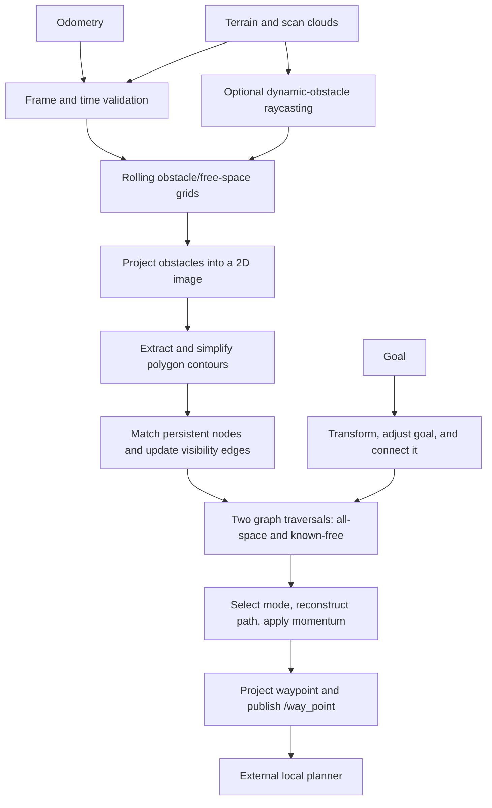

# FAR Planner: algorithm, data flow, and refactor plan

This document records the implementation on the `refactor/*` branches. It describes the current code, distinguishes findings from proposed changes, and defines checks for incremental refactoring. The algorithm is shared across ROS 1 and ROS 2; scheduling, messages, TF APIs, and build dependencies differ.

## Main idea

FAR represents obstacles as polygons and routes through a persistent visibility graph. It rebuilds local obstacle contours from terrain data, matches their vertices to persistent navigation nodes, and re-evaluates nearby graph edges. Searching this sparse graph avoids searching the full point cloud for each goal.

There are two navigation modes: a route constrained to observed/covered space, and an attemptable route that can extend toward unknown space. Goal adjustment, edge-vote history, and path momentum stabilize decisions as observations change. The output is an intermediate waypoint for a separate local planner, not direct velocity control.

## Implementation map

| Stage | Main implementation | Responsibility |
| --- | --- | --- |
| Orchestration | [far_planner.cpp](../src/far_planner/src/far_planner.cpp), `FARMaster` | Sensor callbacks, scheduling, goal lifecycle, waypoint publication |
| Local map | [map_handler.cpp](../src/far_planner/src/map_handler.cpp), `MapHandler` | Rolling obstacle/free-cloud cells, terrain heights, neighborhood queries |
| Dynamic observations | [scan_handler.cpp](../src/far_planner/src/scan_handler.cpp), `ScanHandler` | Voxel raycasting and scan-versus-map obstacle comparison |
| Polygon extraction | [contour_detector.cpp](../src/far_planner/src/contour_detector.cpp), `ContourDetector` | Image projection, blur, contour extraction, polygon simplification |
| Contour topology | [contour_graph.cpp](../src/far_planner/src/contour_graph.cpp), `ContourGraph` | Polygon orientation, convexity, persistent-node matching, intersection tests |
| Graph maintenance | [dynamic_graph.cpp](../src/far_planner/src/dynamic_graph.cpp), `DynamicGraph` | Node creation/removal, visibility/contour/trajectory edges, temporal votes |
| Route selection | [graph_planner.cpp](../src/far_planner/src/graph_planner.cpp), `GraphPlanner` | Goal connection, graph search, mode selection, path reconstruction |
| Terrain connectivity | [terrain_planner.cpp](../src/far_planner/src/terrain_planner.cpp), `TerrainPlanner` | Local eight-neighbor grid search for trajectory-edge feasibility |
| Graph exchange | [graph_msger.cpp](../src/far_planner/src/graph_msger.cpp), [decoder_node.cpp](../src/graph_decoder/src/decoder_node.cpp) | Graph messages, graph import/export, saved graph loading |
| Boundary preprocessing | [graph_extractor.cpp](../src/boundary_handler/src/graph_extractor.cpp) | Build a graph from a supplied polygon boundary and reference trajectory |

## One update cycle

1. **Accept observations.** Odometry sets robot position and heading. Cloud callbacks convert incoming data to PCL, filter invalid points, downsample it, and transform it into `world_frame`. Terrain point intensity is compared with `FARUtil::kFreeZ` to divide free and obstacle samples; it is not simply reflectivity throughout this pipeline.
2. **Update local map state.** `TerrainCallBack` updates rolling map cells and terrain heights, extracts nearby clouds, and maintains time-decayed new-obstacle clouds. In dynamic mode, scan raycasting detects discrepancies and removes obsolete obstacle observations.
3. **Build local contour topology.** `ContourDetector` projects obstacles to an XY image, inflates pixel occupancy, resizes/blurs it, calls OpenCV `findContours`, and applies `approxPolyDP` plus topology/adjacency filters. `ContourGraph` builds polygon-linked contour nodes and classifies surface directions and convexity. Terrain data supplies node heights: this is not a full arbitrary 3D visibility graph.
4. **Maintain the persistent graph.** Match nearby old nodes to current contour vertices; add valid unmatched vertices and intermediate trajectory nodes. Remove merged/invalid nodes and update odometry connections. Recheck pairs of nearby nodes, relevant old edges, and contour-boundary connections. Edge decisions combine direction constraints, polygon intersection, terrain feasibility, and accumulated votes. Already traversed trajectory connections provide additional connectivity.
5. **Prepare route search.** Adjust the goal against local free/obstacle terrain and refresh goal edges. Initialize distances and parent pointers. One Dijkstra-style traversal fills `gscore`/`parent`; a second fills `fgscore`/`free_parent` using covered neighbors and stricter goal admissibility. Costs are Euclidean distance, with a slope-related adjustment for certain goal edges in the general traversal.
6. **Choose and publish.** `PathToGoal` selects the known-free or attemptable parent tree, applies bounded path momentum, reconstructs a route, and chooses the next unreached navigation node. `ProjectNavWaypoint` can extend around convex corners and blend heading. `/way_point` feeds the external local planner; failure handling can publish the robot's current position to stop it.

`TerrainPlanner` is a separate A*-style search over an eight-neighbor local grid, constrained to a corridor around a candidate trajectory edge. It does not replace the persistent visibility-graph route search.

## State and scheduling

`Polygon` and `CTNode` represent local topology. `NavNode` stores persistent geometry, multiple adjacency lists, vote histories, coverage flags, and search state. `FARUtil`, `DynamicGraph`, `ContourGraph`, and `MapHandler` also hold substantial static state. Containers often copy shared pointers, so a copied node vector is not an immutable graph snapshot.

On ROS 2, both graph-update and planning wall timers use `main_run_freq`, and `main()` calls `rclcpp::spin(node)`: the planner callbacks are serialized by the single-threaded executor. The TF listener may use its own thread. On ROS 1, the main loop calls `ros::spinOnce()` and performs graph work; the planning timer runs through that callback processing. The repository's implementation should not be described as two independently parallel planner threads. Introducing parallel callbacks requires a separate ownership/synchronization design.

## TF and timestamp contract

A measurement in frame `sensor` at time `t` must use `T_world_sensor(t)`, with target frame first and source frame second in the lookup. A nonzero input timestamp must not silently become a latest-transform query. TF time zero explicitly requests the latest available transform; a bounded wait can accommodate delayed TF delivery. See the [official tf2 time tutorial](https://raw.githubusercontent.com/ros2/ros2_documentation/jazzy/source/Tutorials/Intermediate/Tf2/Learning-About-Tf2-And-Time-Cpp.rst). A [TF message filter](https://raw.githubusercontent.com/ros2/ros2_documentation/jazzy/source/Tutorials/Intermediate/Tf2/Using-Stamped-Datatypes-With-Tf2-Ros-MessageFilter.rst) can queue stamped inputs until their transforms are available.

The timestamped-transform stage fixes the following confirmed defects:

- Cloud and odometry lookups use the original ROS measurement timestamp, including nanoseconds before PCL rounds timestamps to microseconds. Identity-frame clouds also receive that timestamp in PCL metadata, so both transform paths report the same measurement time. Stamped measurements never request the latest pose.
- `ProcessCloud` builds a candidate and commits it only after a successful transform. Its callers return on failure before changing map state. Goal transform failures also propagate and prevent goal replacement.
- Empty frame IDs are rejected; leading slashes are normalized consistently. Zero-stamped sensor clouds and odometry are rejected. Zero remains an explicit latest-transform request for operator goals.
- TF queries do not block the planner executor. Bounded odometry, scan, local-terrain, and terrain queues wait for their stamped TF and, where needed, matching odometry without silently using the latest transform.

The cross-stream timing stage adds the following policies:

- Each odometry, scan, local-terrain, and terrain stream must advance strictly in timestamp order. Rejected observations do not advance the accepted stamp. Odometry also requires finite coordinates and a nonzero finite quaternion; valid samples wait in order for delayed stamped TF.
- Scans require exact or interpolated world-frame odometry at their timestamp. History retains at most 2,000 samples and 10 seconds; both interpolation samples must be within `sensor_time_tolerance`, with no extrapolation. Scans can wait briefly for the later sample. Rays start at the timestamped sensor-frame TF origin when available, or at interpolated odometry for world-frame scans.
- Terrain clouds also require exact or interpolated odometry at their header stamp. Each interpolation sample and the latest accepted odometry must be within `sensor_time_tolerance` of that stamp. The terrain cloud waits for later odometry or TF in a two-entry, steady-time-expiring queue. Its map crop, neighborhood, and terrain-height traversal use the measurement-time pose; delayed clouds outside the tolerance are dropped rather than mapped at the latest pose.
- Dynamic-obstacle clearing runs only when scan and terrain timestamps differ by at most `sensor_time_tolerance`. Otherwise the map update proceeds without scan-based clearing. Existing dynamic exclusions continue to decay.
- `sensor_time_tolerance` defaults to **0.2 seconds** and must be in `(0, 10]`. Configure it in the planner parameters (`/far_planner/sensor_time_tolerance` on ROS 1) to match the upstream publication rate and motion/error budget. A larger value permits greater temporal mismatch; it does not improve synchronization.
- All inputs must use the planner's ROS clock. Zero sensor stamps and stamps ahead of that clock by more than the tolerance are rejected. A backward clock jump clears the ROS 1 TF listener immediately, along with sensor history, map, graph, and goal state; otherwise a new-epoch sensor could use an old cached TF before the listener receives another TF message. The planner publishes a stop waypoint and waits for fresh odometry/terrain. Explicit graph reset also clears cached observations. The TF provider must supply transforms for the new epoch.

`test/test_frame_transforms.cpp` covers moving transforms, interpolation, nanosecond precision, unavailable/past/future TF, zero stamps, frame normalization, and unchanged inputs on failure. `test/test_sensor_timing.cpp` covers bounded history, ordered/expiring queues, interpolation limits, skew, and clock-rewind detection. The ROS 2 `test/test_terrain_tf.py` exercises timestamped cloud conversion, atomic rejection, delayed TF for odometry, scans, and terrain, terrain-time cropping, invalid/out-of-order odometry, duplicate terrain, skew rejection, and simulated-time reset. The ROS 1 `test/test_scan_tf_ros1.py` exercises delayed odometry and TF in the running node; `test/test_tf_epoch_ros1.py` checks that a clock rewind invalidates old TF before a new TF message arrives.

Remaining limits are explicit:

- Odometry, scans, local-terrain, and terrain retry only within their bounded queue lifetimes; TF arriving after expiry cannot recover that observation. The 0.2-second tolerance is a configurable policy, not a verified setting for every robot.
- World-frame scan clouds have no separate sensor frame, so their rays still start at the odometry reference point. Sensor-frame scans use their timestamped TF origin. A rigid cloud transform does not deskew a spinning scan; upstream per-point timing and motion compensation are required.
- Local terrain is ordered but has no maximum-age gate against graph-update time. Aggregated terrain maps also need a documented upstream frame/time convention; they cannot be made simultaneous with a scan by assigning one header stamp. Graph publication time is not an aggregate observation time.
- These tests do not establish end-to-end navigation correctness. Validate synchronized bag replay and motion on the actual robot before adopting the refactor branches.

## Search correctness stage

The two visibility-graph traversals and terrain A* now push an immutable cost with each queue entry. Every distance improvement adds a new entry; an older entry is skipped when popped. This removes both mutable comparator keys and the separate open-set bookkeeping. The general graph traversal retains its slope-adjusted goal cost, while the covered traversal retains its coverage and free-goal restrictions. Terrain A* still uses Euclidean step costs and a Euclidean heuristic.

A five-node geometric graph demonstrated the old failure: the cost to node 1 settled at 45 instead of the 44.89018 route through node 3. `test/test_search.cpp` now checks both graph traversals against an independent quadratic shortest-path reference over 40 deterministic graphs with covered/uncovered nodes. It also checks an obstacle-grid terrain route. These tests establish search behavior for the covered cases, not the whole navigation stack.

## Graph lifecycle stage

`EraseNodeFromStack` now uses stable remove-and-erase for all matching pointers, including the first element and adjacent copies. Merged-node removal uses the iterator returned by `erase`, so removing the first or consecutive nodes does not decrement past `begin()`.

A full graph reset now clears reciprocal navigation edges, potential connections, trajectory links, search-parent links, and navigation-to-contour references before releasing graph storage. Full contour reset clears the reciprocal vertex links and contour-node edges. `test/test_graph_lifecycle.cpp` verifies first/last/consecutive erasure and that linked navigation and contour vertices are actually destroyed after reset; both ownership tests failed before the fix.

Normal contour replacement now clears reciprocal front/back and connection links before dropping the old topology. Navigation nodes may still hold an old vertex until rematching later in the same serialized update, but that vertex no longer retains its old polygon neighbors. A lifecycle test confirms retired vertices are released after the last navigation reference is removed. Long-running heap profiling is still needed to rule out other ownership growth.

Pillar classification now uses the closed polygon perimeter, including the last-to-first edge. A regression triangle has a 7 m open chain and a 12 m perimeter, crossing a 10 m pillar threshold. The pillar fallback also sets both surface directions to its sentinel value.

Default `Point3D` values now initialize XYZ and intensity to zero in the planner, boundary extractor, and graph decoder. Contour pixels construct a complete point directly, so their intensity is defined before any conversion to a PCL point.

## Boundary input stage

The boundary extractor now reads ASCII PLY through a bounded, checked parser. It requires `element vertex N` and `end_header`, accepts at most one million finite XYZI vertices, and rejects truncated rows before modifying the accepted cloud or polygon stack. The trajectory reader requires finite X, Y, and Z values; extra trajectory fields remain allowed for the sample format. File streams close automatically, and the executable reports an input error without saving a partial graph. Parser unit tests cover malformed headers, missing coordinates, nonfinite values, and oversized IDs. Process smoke checks verify the sample still produces 25 nodes and malformed input exits without a graph.

## Saved graph decoder stage

The decoder now parses the complete saved graph before publishing it. Each line requires the 15 scalar fields and three `|` separators; the four connection groups may be empty. IDs use the message's full `uint32` range, including the final token on a line without a trailing space. Invalid coordinates, duplicate IDs, missing fields, and references to absent nodes reject the file without publishing a partial graph. Parser tests read both bundled `.vgh` files and exercise malformed input.

Incoming graph messages are built before replacing the last accepted graph. Replacing or destroying a decoder graph clears its strong connection links; temporary graphs loaded from files release their links after publication. This prevents reciprocal edges from retaining old graph nodes on repeated updates.

Incoming decoded graph messages now validate their world frame, finite node positions and surface directions, direction count and type, unique IDs, and every connection target before touching the persistent graph. This prevents a missing `surface_dirs[1]` access and avoids partial graph updates on malformed input. The callback also reads the shared message by reference instead of copying the full node and edge arrays.

Graph publishers set the graph header and each node header to the same world frame and publication timestamp. The stamp describes when the accumulated graph snapshot was published; its geometry can include older observations. Incoming graphs must declare the expected node count, and every node frame must match the graph frame. The receiver does not silently transform mismatched node coordinates.

## Graph exchange spatial index stage

`GraphMsger` now packs only searchable nodes into its KD-tree cloud and keeps a parallel pointer for each point. Search returns the exact node pointer, avoiding both empty/ghost slots and loss of integer ID precision through a float intensity field. PCL returns squared distances, so the matcher compares them with the squared linear radius. Tests cover skipped nodes, a large ID, radius semantics, empty rebuilds, and invalid queries.

## Scan sensor origin stage

When a scan arrives in a sensor frame, the cloud transform also supplies the sensor's world-frame translation at that same scan timestamp. Scan ray tracing starts from that translation, accounting for the scanner's offset from the odometry body. A scan already in the world frame still uses the interpolated odometry position because its original sensor frame is unavailable. Failed TF leaves both the accepted cloud and ray origin unchanged. Moving-TF regression tests cover the returned origin, interpolation, identity fallback, and failure.

Scans that arrive before their later odometry sample now wait in a timestamp-ordered queue. When odometry advances, the planner interpolates the scan position from nearby samples, transforms the scan, then updates the ray grid. The queue holds at most 32 scans and discards scans that have waited longer than twice the configured tolerance (at least one second), measured by steady time so delayed replay stamps remain valid; clock rewind and graph reset clear it. Duplicate and out-of-order scans are rejected. Unit tests cover queue ordering, bounds, expiry, and reset; a ROS 2 callback test verifies a scan received before its later odometry is eventually ray traced. If scan TF is missing, the head scan stays queued and later scans retain timestamp order. ROS 2 retries every 50 ms; ROS 1 retries on each serialized main-loop iteration. Invalid scans are removed, and scans waiting beyond the steady-time limit expire with a diagnostic. The live ROS 1 rostest and ROS 2 callback test deliver TF after a scan and verify that processing resumes without another scan or odometry callback.

Terrain uses the same nonblocking retry schedule but keeps at most two clouds because terrain messages can be large. It waits for a bracketing odometry sample, uses that interpolated pose for map cropping and terrain-height analysis, and retries a missing stamped TF. The latest odometry must also be within the configured tolerance of the cloud stamp so old terrain cannot replace the current local view. Terrain is processed in stamp order; clock rewind and graph reset clear the queue.

Odometry keeps at most 200 small messages while waiting for their stamped world-frame TF. Samples are processed in order, and each accepted pose releases scans and terrain waiting on that time. The queue expires samples after twice the configured tolerance (at least one steady-time second) and clears on clock rewind or graph reset; later samples can advance after an expired head. ROS 2 retries every 50 ms, while ROS 1 retries on main-loop iterations and new odometry callbacks.

Local terrain keeps at most two clouds and follows the same stamped-TF retry and expiry policy. It does not require odometry interpolation; once transformed, its obstacle/free cloud replaces the previous local-terrain view. Accepted local terrain remains available to graph updates until replaced or reset.

## Invariants to preserve

- Every accepted geometric value used by the planner is in the configured world frame. Failed or unavailable transforms must not mutate accepted map, odometry, or goal state.
- Node IDs remain stable and resolve to live nodes; deleting a node removes its adjacency, vote, and lookup references.
- Undirected graph operations maintain reciprocal edges. Known-free and attemptable graph policies remain distinct.
- Search costs are nonnegative. Priority-queue keys must remain valid after a distance improvement; the parent chain must terminate at the start.
- Geometry thresholds, boundary restrictions, and momentum behavior are preserved unless a separately tested behavior change is intentional.
- Optimization must not remove defensive copies where an operation mutates the container being traversed.

## Step-by-step simplification and efficiency work

| Step | Change | Required evidence |
| --- | --- | --- |
| 1 — foundation | Branch-specific dependencies/builds, portable setup, MIT notices, plugin cleanup | Native Jazzy/Lyrical/Noetic builds; launch and plugin smoke checks |
| 2 — frame/time correctness | Timestamped TF queries and explicit failure propagation, then cross-stream timing policy | Moving transforms at distinct times; unavailable/past/future TF; zero stamps; simulated-time jumps; unchanged state on failure |
| 3 — search correctness | Audit mutable priority-queue keys in both graph traversals and terrain search; consolidate only identical mechanics | A graph where a queued node's best cost decreases; reference shortest-path comparisons; covered-space constraints |
| 4 — graph lifecycle | Replace invalid `erase(it--)` loops; audit ownership cycles, ID maps, and adjacency cleanup | Remove first/last/consecutive nodes; repeated resets; sanitizer checks and live-node accounting |
| 5 — file boundaries | Validate graph/boundary/trajectory input and fail without partial state updates | Truncated/malformed files, missing fields, large IDs, round trips, invalid coordinates |
| 6 — measured hot paths | Remove proven unnecessary copies/allocations; bound pair iteration; avoid avoidable rebuilds | Identical graph/path results; allocation counts; median/p95 stage timing over representative graph sizes |

Confirmed input and graph-index defects have regression coverage: trajectory Y/Z validation, bounded PLY parsing with a required vertex count, compact KD-tree points, exact node identity, radius units, finite point-cloud conversion, and empty KD-tree queries. Empty cloud updates no longer insert a synthetic point at the world origin. Obstacle and free-grid updates now filter only cells touched by the incoming cloud, removing two full-grid passes per update; each touched cell is still filtered once. Dynamic-obstacle removal likewise checks only cells named by its incoming cloud. A sparse visited-cell index drives occupancy visualization and map reset without traversing the full grid. `test/test_map_handler.cpp` verifies repeated updates, removals, occupancy enumeration, and reset. These are code-level complexity improvements, not end-to-end speed measurements. Cloud filter and crop helpers now swap their completed output buffers into place, removing an extra full-cloud copy on those paths. Cloud decay now compacts surviving points in place, retains their order, and uses one ROS-time reading for tagging and expiry instead of allocating an index list and filtering into a second cloud. Remaining work includes long-running memory profiling and measured hot-path changes.

Potential costs are point-cloud conversion/downsampling and neighborhood reconstruction, image processing, roughly quadratic nearby-node pair checks, graph serialization/KD-tree rebuilds, and graph traversals. Complexity is a prioritization aid, not a measured bottleneck. Existing `/runtime` and `/planning_time` measurements cover different scopes and units; normalize benchmark reporting before comparing them. Record point count, contour/graph size, edge count, configuration, CPU, ROS version, and correctness results with each performance claim.

`Grid` computes an index's three coordinates when requested instead of storing them for every cell. The constructor rejects invalid dimensions, nonpositive resolutions, and cell counts beyond its `int` index range before allocation. World obstacle/free cloud grids now use sparse storage and allocate clouds only for cells receiving points. Empty reads do not create cells; reset and obstacle removal release empty entries. Per-update sets replace three dense marker arrays. Terrain-height and scan grids remain dense because their local dimensions are much smaller. Startup now validates timer frequency and geometry settings before dividing or converting to integer grid and image sizes. Invalid values produce a named startup error; oversized derived dimensions are rejected before allocation. Contour resize bookkeeping uses the same rounded output size as OpenCV, including fractional ratios. Grid position conversion now keeps extreme or nonfinite coordinates outside the index range without an overflowing integer cast. Ray traces use double precision for squared distances and stop immediately for invalid starts. Goal-grid searches require an in-range seed; scan inflation skips points too distant to affect its local grid and caps angular expansion by the grid dimensions.

In a four-second Noetic desktop-container smoke test, the planner completed initialization with its code-default 5 km map span and reached 101,620 KB peak RSS before receiving sensor data. This is an empty-map startup observation, not a bound on memory after mapping.

An isolated retention-stage benchmark is reproducible with `cmake -S benchmarks -B /tmp/far-cloud-decay-build -DCMAKE_BUILD_TYPE=Release`, `cmake --build /tmp/far-cloud-decay-build`, and `/tmp/far-cloud-decay-build/cloud_decay`. `benchmarks/COLCON_IGNORE` keeps this optional build out of normal workspace builds. On an i9-12900K with GCC 13.3 and PCL 1.14, half the points expired; runs alternated implementation order. Median/p95 milliseconds were:

| Points | `ExtractIndices` | In-place compaction | Runs |
| ---: | ---: | ---: | ---: |
| 100,000 | 1.02 / 1.20 | 0.075 / 0.100 | 30 |
| 1,000,000 | 16.62 / 17.70 | 2.24 / 2.47 | 12 |

`kNavClearDist` is derived as `robot_dim / 2 + voxel_dim`. The graph connection angle and direction filter margin follow `util/accept_max_align_angle` and `util/angle_noise` after degree-to-radian conversion (ROS 1 uses `Util/` and `Graph/` prefixes). The former `nav_clear_dist`, `graph/connect_angle_thred`, and `graph/dirs_filter_margin` parameter reads were overwritten before use and have been removed. The `g_planner/free_counter_thred` setting was also unused and has been removed from both shipped configurations and `GraphPlannerParams` (ROS 1 uses `GPlanner/`).

The optional `grid_position` target in the same benchmark build compares five million in-range conversions with the previous unchecked formula: `cmake --build /tmp/far-cloud-decay-build --target grid_position` and `/tmp/far-cloud-decay-build/grid_position`. A local Release run measured about 6.6 ms for the old formula and 11.4 ms for the checked conversion. This synthetic check excludes TF, PCL, and map updates; it measures the cost of the new safety checks, not planner throughput.

The benchmark measures only retention, excluding cloud copies used to prepare the input, ROS callbacks, and planning. Representative planner stage latency remains unmeasured.

## Branch validation baseline

The foundation builds on native Jazzy and on official Noetic and Lyrical desktop containers. Jazzy and Lyrical report 232 checks, zero failures, and 58 skips; these are predominantly lint/generated-code checks. Noetic initially registers zero behavioral tests. Headless planner startup, decoder remapping, and generation of a 25-node example boundary graph pass on all three tested distributions. These checks do not establish end-to-end navigation correctness; the refactor must add behavioral regressions and representative replay/simulation validation.
