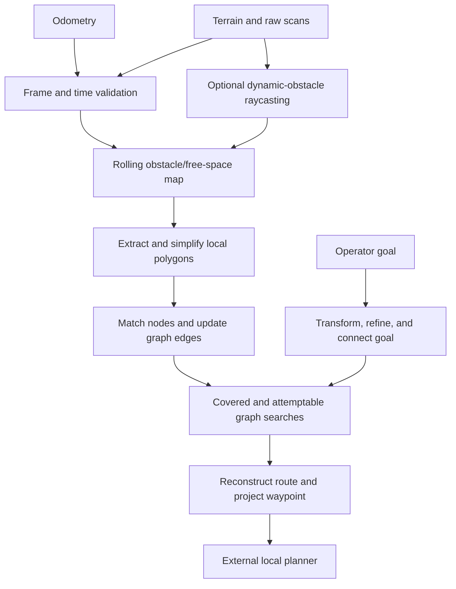

# FAR Planner algorithm

FAR plans through a persistent visibility graph built from observed terrain. It extracts local obstacle polygons, matches their corners to navigation nodes, updates nearby edges, and searches the resulting graph. The output is an intermediate waypoint for a separate local planner; FAR does not command vehicle velocity directly.

This guide describes the shared ROS 1/ROS 2 implementation. The [validation record](validation.md) contains regression cases, source revisions, measured optimizations, SDK checks, and known failures. Use the README on your branch for build and launch commands.

## Main idea

The local polygon model makes visibility checks cheaper than repeatedly searching an entire point cloud. Persistent nodes retain useful geometry and traversed trajectory connections as the robot moves. Edge votes, goal adjustment, and bounded path momentum stabilize decisions across observations.

The planner maintains two routes: a covered-space route and an attemptable route that can extend into unknown space. An attemptable edge is a navigation hypothesis that can fail when the robot observes more of the environment. The polygon representation is based on XY contours with terrain-derived heights; it is not an arbitrary 3D visibility graph.

## Implementation map

| Component | Main implementation | Responsibility |
| --- | --- | --- |
| Orchestration | [far_planner.cpp](../src/far_planner/src/far_planner.cpp), `FARMaster` | Callbacks, scheduling, goal lifecycle, waypoint publication |
| Local map | [map_handler.cpp](../src/far_planner/src/map_handler.cpp), `MapHandler` | Sparse world cloud cells, terrain heights, local queries |
| Dynamic observations | [scan_handler.cpp](../src/far_planner/src/scan_handler.cpp), `ScanHandler` | Voxel raycasting and scan-versus-map differences |
| Local geometry | [contour_detector.cpp](../src/far_planner/src/contour_detector.cpp), [contour_graph.cpp](../src/far_planner/src/contour_graph.cpp) | Image contours, polygon simplification, corner classification, matching and intersections |
| Graph maintenance | [dynamic_graph.cpp](../src/far_planner/src/dynamic_graph.cpp), `DynamicGraph` | Node lifecycle, visibility/contour/trajectory edges and votes |
| Route selection | [graph_planner.cpp](../src/far_planner/src/graph_planner.cpp), `GraphPlanner` | Goal connection, two graph searches, mode selection, path momentum |
| Terrain feasibility | [terrain_planner.cpp](../src/far_planner/src/terrain_planner.cpp), `TerrainPlanner` | Local eight-neighbor search for trajectory-edge feasibility |
| Graph exchange | [graph_msger.cpp](../src/far_planner/src/graph_msger.cpp), [decoder_node.cpp](../src/graph_decoder/src/decoder_node.cpp) | Validated graph messages, imports, saved graphs and atomic export |
| Boundary preprocessing | [graph_extractor.cpp](../src/boundary_handler/src/graph_extractor.cpp) | Build a graph from polygon boundaries and a reference trajectory |

## One update cycle

1. **Accept observations.** Validate layouts, finite values, frames, and timestamps. Transform each input at its measurement time and match clouds to exact or interpolated odometry. Commit accepted candidates before updating map state.
2. **Maintain the local map.** Terrain intensity separates free and obstacle samples. Update touched world-map cells and terrain heights. In dynamic mode, compatible raw scans identify previously occupied cells now traversed by rays; temporary exclusions prevent retained upstream terrain from immediately restoring those points.
3. **Extract local geometry.** Project obstacles to an XY image, inflate occupancy, resize/blur, and use OpenCV contours and polygon approximation. Build polygon rings, classify corner surface directions, and obtain heights from terrain.
4. **Maintain the persistent graph.** Match old nodes to current corners, add valid unmatched corners and trajectory samples, retire invalid/merged nodes, and recheck relevant edges. Direction, polygon-intersection, terrain-feasibility and vote-history checks determine connectivity.
5. **Prepare searches.** Refine the goal, update its connections, and traverse from odometry twice. The general traversal uses Euclidean edge costs with the existing slope-related goal adjustment. The covered traversal applies coverage and free-goal restrictions. Both graph queues break exactly equal-cost ties by ascending node ID.
6. **Publish guidance.** Select the parent tree, reconstruct a route, apply bounded momentum, choose an unreached navigation node, and project its waypoint. Publish `/way_point` for the external local planner. Failure handling can publish the robot position as a stop waypoint.

`TerrainPlanner` is separate from the visibility-graph searches. It runs A* over an eight-neighbor local grid in a corridor around a candidate trajectory edge. Diagonal moves require both adjacent cardinal cells to be free. Queue entries store immutable costs; stale entries are skipped after a better route is found.

## State and scheduling

Planner callbacks are serialized. On ROS 2, graph and planning wall timers use `main_run_freq`, and the entry point spins the node. On ROS 1, `ros::spin()` services callbacks continuously, graph/planning use separate ROS timers, and a 50 ms wall timer retries pending observations even while simulated time is paused. A TF listener may have its own thread. Parallel planner callbacks would require an explicit synchronization design.

`FARUtil`, `DynamicGraph`, `ContourGraph`, and `MapHandler` hold substantial static state. Copying a vector of shared node pointers does not produce an immutable graph snapshot. Node factories initialize nodes before insertion; contour construction closes non-pillar rings before surface analysis. Configuration must be loaded and validated before module initialization derives dimensions and thresholds.

Idle planning refreshes the authoritative graph snapshot before searching, including nodes imported between timer ticks.

Node retirement and reset must remove reciprocal adjacency, contour links, parent references, vote records, and ID-index entries before releasing owning containers. The planner and graph utilities also break ownership cycles during destruction. See the [lifecycle evidence](validation.md#graph-lifecycle-stage) and [startup checks](validation.md#initialization-and-scheduling-checks).

## TF and timestamp contract

For a sensor measurement at time `t`, query `T_world_sensor(t)`: target frame first, source frame second. Preserve the original ROS nanoseconds for lookup before PCL rounds metadata to microseconds. A nonzero sensor stamp must never become a latest-transform query. Zero stamps are rejected for sensor inputs; an operator goal may explicitly request the latest transform with time zero.

The default launch uses:

| Planner input | Default topic | Meaning |
| --- | --- | --- |
| `/odom_world` | `/state_estimation` | Stamped robot pose |
| `/scan_cloud` | `/registered_scan` | Registered raw returns for ray tracing; intensity optional |
| `/terrain_cloud` | `/terrain_map_ext` | Extended terrain with height cost in intensity |
| `/terrain_local_cloud` | `/terrain_map` | Local terrain with height cost in intensity |

Reflectivity is not a terrain height cost. For example, zero reflectivity on a wall must not make it traversable. Terrain inputs require distinct native-endian float32 XYZ/intensity fields and finite intensity; raw scans require XYZ. Malformed layouts are rejected before queueing. An explicit empty local-terrain measurement can clear local occupancy.

All streams use the same ROS clock and advance strictly by accepted timestamp. Reject invalid odometry, duplicate/out-of-order inputs, and stamps ahead of the clock by more than `sensor_time_tolerance`. Failed inputs do not advance accepted stamps or partially replace state.

Clouds require exact or interpolated odometry at their own timestamp. Each bracketing sample must lie within the tolerance; there is no pose extrapolation. History retains at most 2,000 samples and 10 seconds. A cloud already too far behind current odometry is rejected on arrival. Once queued, later odometry does not invalidate an otherwise valid historical match.

TF queries do not block the planner executor. Pending queues bound odometry to 200 messages, scans to 32, and each terrain stream to two. Steady-time expiry prevents a paused ROS clock from retaining inputs indefinitely. Reset and clock rewind clear pending observations. ROS 1 also immediately invalidates its TF cache on rewind; fresh transforms must describe the new epoch.

Dynamic clearing selects the nearest processed scan within the terrain timestamp tolerance, preferring the earlier scan on a tie, and restores its measurement-time sensor origin. Up to 32 processed scans are retained. Terrain may wait up to 250 ms for a compatible scan; a second queued terrain releases the older one immediately. After the wait, map updates can proceed without scan-based clearing.

Default `sensor_time_tolerance` is 0.2 seconds and must be in `(0, 10]`. Increasing it permits more temporal mismatch. Dynamic exclusions default to 15 seconds and must outlast upstream terrain retention and pruning lag; a new cloud header does not make every retained point fresh. Spinning scans require upstream deskewing because one header stamp cannot describe every point's acquisition time.

The 15-second exclusion is not a lifetime for occupied map points. Dynamic clearing needs ray evidence that an occupied cell is now free; geometry outside that evidence can remain until re-observed. The route policy does not guarantee an active return to such a viewpoint.

Detailed [TF/timing regressions](validation.md#tf-and-timestamp-contract) and [retention experiments](validation.md#dynamic-terrain-retention-validation) define the tested scope.

## Goal and route semantics

Goal refinement receives current odometry explicitly. In single-layer mode, terrain can adjust goal height. Multi-layer classification compares obstacle height with the goal layer and adds `vehicle_height` to ground evidence before comparing free samples. A free sample overlapping an inflated obstacle does not make that goal-grid cell free.

A nearby existing navigation node can become the goal anchor. `PathToGoal` reports arrival within `g_planner/converge_distance` (`GPlanner/converge_distance` on ROS 1) of the active refined goal or initialization anchor. That anchor can already be snapped away from the original request. Free-grid and polygon projection can further move the active goal; `goal_adjust_radius` does not bound the later polygon projection.

Consequently, an arrival status is not a requested-XYZ guarantee. Tests that require exact request proximity must check the robot position independently. The [controlled goal probe](validation.md#search-correctness-stage), [garage runs](validation.md#garage-ramp-navigation-validation), and recorded failures preserve that distinction.

## Simplification and efficiency

The refactor concentrates on reducing repeated work while preserving decision order and explicit invariants:

- Remove unused node fields, lidar constants, and private helpers.
- Reuse settled-node flags instead of allocating duplicate closed-node hash sets.
- Filter touched cloud cells and enumerate sparse visited cells instead of scanning the entire world grid.
- Reuse terrain projections by accepted-cloud revision and reset search state only for previously touched cells.
- Visit nearby node pairs once; retain defensive copies when adjacency is mutated during traversal.
- Swap completed cloud buffers, compact retained points/contours in place, and select top contour votes without sorting a temporary vector.
- Skip visualization construction when there are no subscribers and trim unused build/runtime dependencies.

The [benchmark record](validation.md#step-by-step-simplification-and-efficiency-work) reports timing/allocation scope, controls, and regressions. Improvements to isolated stages do not imply a universal whole-planner speedup.

## Invariants to preserve

- Transform and validate candidates before committing map, graph, or goal state.
- Keep IDs unique and every published connection resolvable; maintain reciprocal edges when removing nodes.
- Keep search queue keys immutable and costs consistent with the selected route mode.
- Preserve branch-specific ROS, PCL, compiler, and Qt APIs; use Qt6 on Lyrical and Qt5 on the other supported SDKs.
- Distinguish observed clearing from unobserved geometry outside the local view; a finite successful route does not establish all dynamic-navigation behavior.

The [validation record](validation.md) documents the six refactor stages, current SDK coverage, successful and failed integration workloads, and remaining limitations. [Source migration notes](validation.md#source-migration-notes) describe changed helper signatures, removed wrappers/settings, and RViz header paths.
